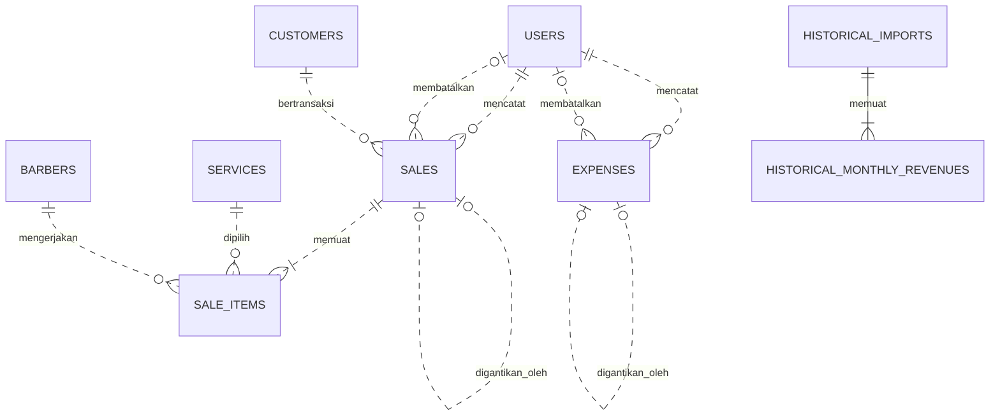

# Desain Database MySQL Sistem Manajemen Operasional Barbershop

**Kelompok 6, Kelas 2023C · Draf untuk peninjauan sebelum implementasi**

Project Charter menetapkan operasional satu lokasi, dua peran, master layanan dan harga, kapster, pelanggan, POS dengan pembayaran manual, pemasukan otomatis, pengeluaran manual, laporan pendapatan, serta satu model Regresi Linier Python. Data historis transaksi yang diminta mencakup minimal Juli–September 2026 dalam CSV/Excel. QMP v1.1 menetapkan Pangkas Rambut Upin Ipin 11 sebagai lokasi uji serta kriteria KP-01 sampai KP-07. Rencana backend memberi konteks pengerjaan. [Project Charter, hlm. 1–2](../menpro%202.pdf) · [QMP v1.1, hlm. 1 dan 4–6](../Quality%20Management%20Plan_Kelompok%206_2023C.pdf) · [Rencana backend](Rencana-Backend-Sistem-Operasional-Barbershop.md)

## 1. Keputusan yang memengaruhi skema

| Topik | Usulan yang dipakai dalam draf | Keputusan terbuka untuk tim dan Owner |
| --- | --- | --- |
| Layanan per transaksi | Satu transaksi untuk satu pelanggan memuat minimal satu item. Setiap item menunjuk satu layanan dan satu kapster, dengan kuantitas bilangan bulat. | Konfirmasi apakah satu struk dapat memuat beberapa layanan atau kapster dan apakah kuantitas di atas satu diperlukan. |
| Akun dan kapster | `users` menyimpan identitas login Kasir/Owner. `barbers` menyimpan kapster pelaksana. Transaksi mencatat kedua identitas melalui FK yang sesuai. | Apakah akun kasir perlu ditautkan ke profil kapster? Jika diperlukan, usulan lanjutan adalah `barbers.user_id` nullable dan unik setelah aturan pemetaan disepakati. |
| Harga historis | Saat transaksi disimpan, salin nama dan harga satuan layanan ke item. Simpan total hasil hitung server di header. | Konfirmasi kebutuhan diskon, layanan gratis, harga khusus, dan apakah nama pelanggan/kapster pada struk lama juga harus dibekukan. Draf membaca nama kedua master tersebut saat ini. |
| Pembayaran manual | Satu metode per transaksi, tunai atau nontunai, dengan pelunasan penuh. Kasir mengonfirmasi penerimaan. | Konfirmasi kebutuhan pembayaran campuran atau sebagian, kanal nontunai, serta kapan referensi pembayaran wajib. |
| Pembatalan dan koreksi | Kasir memasukkan data awal. Usulan memberi Owner wewenang membatalkan catatan dengan alasan dan, bila perlu, membuat satu pengganti. Koreksi data tetap masuk periode kejadian asli. | Siapa yang boleh membatalkan atau mengoreksi? Konfirmasi aturan periode tutup, pengembalian dana, dan pencatatan mundur. Kebijakan pengembalian dana lintas periode perlu disepakati sebelum skemanya ditentukan. |
| Sumber pemasukan | Satu header POS lunas dan aktif menghasilkan satu baris pemasukan otomatis di pembukuan. Total pendapatan berasal dari header tersebut. | Konfirmasi apakah ada pemasukan selain POS atau kebutuhan jurnal pemasukan fisik. |
| Periode laporan | Gunakan tanggal pembayaran POS dan tanggal kejadian pengeluaran. Batas kalender lokal `Asia/Jakarta`, minggu mulai Senin, dengan interval `[awal, akhir)`. | Konfirmasi zona waktu operasional, awal minggu, jam tutup buku, dan apakah laporan periode lalu boleh berubah akibat koreksi. |
| Histori dan peramalan | CSV/Excel disimpan sebagai sumber impor privat. Impor menerbitkan agregat bulanan khusus peramalan. Pilih satu sumber yang telah direkonsiliasi untuk tiap bulan. | Perlu contoh file, konfirmasi cakupan satu lokasi, identitas transaksi, cara menghitung nominal, kelengkapan bulan, titik peralihan ke POS, dan apakah data lama perlu tampil dalam pembukuan. |
| Master dan hak hapus | Tombol hapus pada master mengarsipkan catatan. Data minimum pelanggan adalah nama dan satu pelanggan wajib dipilih per transaksi. | Sepakati arsip sebagai perilaku hapus untuk KP-01 dan tentukan apakah pelanggan tanpa nama dicatat dengan profil umum yang disepakati. |

## 2. ERD usulan



- Setiap `sales` memiliki tepat satu pelanggan, satu pencatat, dan satu atau lebih item. Setiap item memiliki tepat satu layanan dan satu kapster. Satu pelanggan, layanan, atau kapster bisa memiliki nol hingga banyak rujukan.
- Setiap `expenses` memiliki tepat satu pencatat. Penjualan dan pengeluaran masing-masing memiliki nol atau satu akun pembatal. Satu akun dapat mencatat atau membatalkan banyak catatan.
- Satu penjualan atau pengeluaran dapat menggantikan nol atau satu catatan lama dari jenis yang sama dan dapat memiliki paling banyak satu pengganti langsung. Satu impor yang terbit memiliki satu atau lebih agregat bulanan.

## 3. Kamus data

Usulan teknis memakai MySQL InnoDB dan `utf8mb4`. `ID` berarti `BIGINT UNSIGNED`, dengan `AUTO_INCREMENT` untuk PK tunggal `id`. `Rp` berarti `DECIMAL(15,0)` untuk rupiah utuh. `UTC` berarti `DATETIME(6)` dengan nilai disimpan dalam UTC. Kolom wajib diisi kecuali bertanda `NULL`. PK adalah kunci primer, FK kunci asing, dan UQ kunci unik. Konfirmasi dukungan `CHECK` pada versi MySQL target. Lakukan aritmetika Laravel dengan integer yang diperiksa batasnya atau aritmetika desimal presisi eksak. [MySQL `DECIMAL`](https://dev.mysql.com/doc/refman/8.4/en/fixed-point-types.html) · [MySQL `CHECK`](https://dev.mysql.com/doc/refman/8.4/en/create-table-check-constraints.html)

### Akun dan master

| Tabel | Kolom | Arti dan kunci |
| --- | --- | --- |
| `users` | `id ID`, `name VARCHAR(120)`, `email VARCHAR(254)`, `password VARCHAR(255)`, `role ENUM('CASHIER','OWNER')`, `disabled_at UTC NULL`, `created_at UTC`, `updated_at UTC` | `id` PK. `email` UQ, dinormalisasi untuk login. `password` berisi hash Laravel. `disabled_at` menandai akun yang dinonaktifkan. |
| `customers` | `id ID`, `name VARCHAR(120)`, `archived_at UTC NULL`, `created_at UTC`, `updated_at UTC` | `id` PK. Nama pelanggan dapat sama. |
| `barbers` | `id ID`, `name VARCHAR(120)`, `archived_at UTC NULL`, `created_at UTC`, `updated_at UTC` | `id` PK. Nama kapster dapat sama. |
| `services` | `id ID`, `name VARCHAR(120)`, `current_price Rp`, `archived_at UTC NULL`, `created_at UTC`, `updated_at UTC` | `id` PK. `current_price > 0`. |

### Penjualan dan pengeluaran

| Tabel | Kolom | Arti dan kunci |
| --- | --- | --- |
| `sales` | `id ID`, `customer_id ID`, `recorded_by_user_id ID` | `id` PK. FK ke `customers.id` dan `users.id`. `id` juga dapat digunakan sebagai nomor struk internal. |
| `sales` | `paid_at UTC`, `payment_method ENUM('CASH','NON_CASH')`, `total_amount Rp`, `cash_received Rp NULL`, `payment_reference VARCHAR(100) NULL` | Waktu pembayaran yang dipakai laporan. `total_amount` adalah nilai pelunasan. `cash_received` adalah uang yang diserahkan pelanggan tunai. `payment_reference` adalah referensi manual nontunai bila ada. |
| `sale_items` | `id ID`, `sale_id ID`, `service_id ID`, `barber_id ID`, `service_name VARCHAR(120)`, `unit_price Rp`, `quantity SMALLINT UNSIGNED` | `id` PK. FK ke `sales.id`, `services.id`, `barbers.id`. `service_name` dan `unit_price` adalah salinan saat penjualan. Subtotal dihitung dari `quantity × unit_price`. |
| `expenses` | `id ID`, `recorded_by_user_id ID`, `incurred_at UTC`, `description VARCHAR(255)`, `amount Rp` | `id` PK. FK ke `users.id`. `incurred_at` adalah waktu pengeluaran yang dicatat Kasir. `amount > 0`. |
| `sales`, `expenses` | `request_key CHAR(36)` ASCII dengan kolasi biner, `request_hash BINARY(32)`, `created_at UTC` | `request_key` UQ per tabel, berupa UUID permintaan. `request_hash` adalah SHA-256 dari isi permintaan yang telah dinormalisasi. `created_at` mencatat waktu simpan aktual. |
| `sales`, `expenses` | `voided_at UTC NULL`, `voided_by_user_id ID NULL`, `void_reason VARCHAR(255) NULL` | FK pembatal ke `users.id`. Ketiganya terisi saat pembatalan. `voided_at IS NULL` berarti transaksi lunas atau pengeluaran aktif, sesuai tabel. |
| `sales` | `replaces_sale_id ID NULL` | UQ dan FK ke `sales.id`. Diisi pada transaksi pengganti. |
| `expenses` | `replaces_expense_id ID NULL` | UQ dan FK ke `expenses.id`. Diisi pada pengeluaran pengganti. |

### Sumber peramalan historis

Kedua tabel ini merupakan usulan setelah struktur file dikonfirmasi. Masing-masing batch yang terbit merepresentasikan satu versi sumber historis yang dapat dipilih untuk peramalan.

| Tabel | Kolom | Arti dan kunci |
| --- | --- | --- |
| `historical_imports` | `id ID`, `source_name VARCHAR(255)`, `file_sha256 BINARY(32)`, `mapping_version VARCHAR(40)`, `imported_at UTC` | `id` PK. UQ (`file_sha256`, `mapping_version`). `mapping_version` merujuk konfigurasi pemetaan yang disimpan bersama bukti impor, termasuk aturan pembacaan dan normalisasi. |
| `historical_monthly_revenues` | `import_id ID`, `month_start DATE`, `sales_amount Rp`, `transaction_count INT UNSIGNED` | PK (`import_id`, `month_start`), FK `import_id` ke `historical_imports.id`. `month_start` adalah tanggal 1 dalam kalender lokal. `sales_amount >= 0`. `transaction_count` menghitung struk sah setelah rekonsiliasi. |

## 4. Integritas, penghapusan, dan indeks

### Integritas

- **MySQL.** PK, FK, `NOT NULL`, UQ, dan `CHECK` menegakkan aturan per baris. Cek `quantity > 0`, `current_price > 0`, `unit_price > 0`, serta total dan pengeluaran positif. Untuk tunai, `cash_received IS NOT NULL`, `cash_received >= total_amount`, dan `payment_reference IS NULL`. Untuk nontunai, `cash_received IS NULL`. Cek pasangan `voided_at` dan `void_reason`, termasuk alasan yang terisi dan `voided_at >= created_at` saat batal. Cek tanggal 1 pada `month_start` dan nilai agregat nonnegatif. [MySQL `CHECK`](https://dev.mysql.com/doc/refman/8.4/en/create-table-check-constraints.html)
- **Laravel.** Validasi peran serta status aktif pengguna dan master, minimal satu item, dan `total_amount = Σ(quantity × unit_price)`. Terapkan ketiga field pembatalan secara bersamaan, termasuk FK pembatal. Validasi transaksi pengganti terhadap catatan lama yang dikunci. Validasi keterisian teks, format input, dan kisaran nominal sebelum menyimpan. Harga yang dibebankan berasal dari server. Tolak checkout bila total yang disetujui Kasir berbeda dengan total hasil hitung server dan minta konfirmasi ulang setelah harga dimuat kembali.
- **Penghapusan.** Semua FK di atas memakai `ON DELETE RESTRICT` dan `ON UPDATE RESTRICT`. Pengarsipan master mengeluarkannya dari pilihan baru. Relasi riwayat tetap dapat membaca master yang diarsipkan. Akun dinonaktifkan dan akses sesi dicabut. Penjualan, item, dan pengeluaran disimpan sebagai catatan audit. Perubahan nilai dilakukan melalui pembatalan atau penggantian di layanan aplikasi. Batch histori yang dikoreksi diterbitkan sebagai versi baru.

### Indeks utama

| Tabel | Indeks selain PK | Alasan |
| --- | --- | --- |
| `users` | UQ (`email`) | Login. |
| `customers`, `barbers`, `services` | (`archived_at`, `name`) | Pilihan master aktif berdasarkan nama. |
| `sales` | (`voided_at`, `paid_at`), UQ (`request_key`), UQ (`replaces_sale_id`), indeks masing-masing pada `customer_id`, `recorded_by_user_id`, `voided_by_user_id` | Rentang pemasukan aktif, kirim ulang, penggantian, dan FK. |
| `sale_items` | Indeks masing-masing pada `sale_id`, `service_id`, `barber_id` | Baca item struk dan dukungan FK. |
| `expenses` | (`voided_at`, `incurred_at`), UQ (`request_key`), UQ (`replaces_expense_id`), indeks masing-masing pada `recorded_by_user_id`, `voided_by_user_id` | Rentang pengeluaran aktif, kirim ulang, penggantian, dan FK. |
| `historical_imports` | UQ (`file_sha256`, `mapping_version`) | Mendeteksi pemrosesan ulang file dengan aturan yang sama. |
| `historical_monthly_revenues` | PK gabungan sudah mencakup `import_id` | Baca rangkaian bulan per versi impor dan dukungan FK. |

## 5. Alur POS sampai laporan

1. **Kasir mengirim checkout.** Form menyimpan satu `request_key` per upaya checkout dan menggunakannya kembali saat respons hilang. Laravel memeriksa sesi dan peran, lalu membuat hash dari isi permintaan yang stabil, termasuk item, pembayaran, dan total yang disetujui. Permintaan ulang dari pencatat yang sama dengan kunci dan isi sama mengembalikan struk yang sama. Isi berbeda dengan kunci sama ditolak. Pada permintaan paralel, UQ menentukan satu pemenang. Setelah konflik UQ pada `request_key`, akhiri transaksi yang gagal dan baca baris yang menang untuk membandingkan pencatat serta hash. Identitas dua checkout yang sah tetap berbeda walau nilai dan waktu sama.
2. **Simpan secara atomik.** Di dalam `DB::transaction`, ambil dan kunci data master yang dipakai untuk menyelaraskan checkout dengan perubahan harga atau arsip. Hitung subtotal dan total di server. Untuk tunai, kembalian adalah `cash_received − total_amount`. Untuk nontunai, Kasir mengonfirmasi nominal yang sama dengan total. Pada checkout normal, server menetapkan `paid_at` saat konfirmasi pembayaran dan menyimpan presisi mikrodetik. Simpan header dan semua item, lalu berikan struk setelah commit. Kegagalan simpan item menggagalkan seluruh checkout. [Transaksi database Laravel](https://laravel.com/docs/13.x/database#database-transactions) · [Locking reads MySQL](https://dev.mysql.com/doc/refman/8.4/en/innodb-locking-reads.html)
3. **Catat pengeluaran.** Kasir memasukkan tanggal kejadian, deskripsi, dan nominal. Terapkan aturan kunci permintaan yang sama untuk pengeluaran. Pencatat selalu diambil dari sesi. Waktu kejadian dipakai pada laporan dan waktu simpan dipakai pada audit.
4. **Koreksi jika diperlukan.** Periksa `request_key` pengganti terlebih dahulu saat ada permintaan koreksi. Pengguna yang diberi wewenang mengunci header asli, memeriksa bahwa catatan masih aktif, lalu mengisi waktu, akun, dan alasan pembatalan. Untuk koreksi, buat pengganti baru dan simpan pembatalan dalam satu transaksi database. Pengganti memakai waktu kejadian asli, dengan waktu simpan aktual yang baru. Item yang dipertahankan memakai harga historis asli. Rujukan pelanggan, layanan, dan kapster yang dipertahankan boleh tetap menunjuk master yang kini diarsipkan. Perubahan layanan atau harga historis memerlukan bukti harga saat kejadian dan persetujuan pihak yang berwenang. Jika permintaan paralel mendapati header sudah batal, periksa kembali kunci dan isi pengganti sebelum menentukan hasil. Pembatalan ulang membaca status yang sudah tersimpan. UQ pada referensi pengganti dan penguncian catatan asli membatasi pengganti langsung menjadi satu. Laporan periode lama dihitung kembali sesuai usulan ini.
5. **Owner membaca laporan.** Pembukuan dan dashboard memakai sumber serta batas periode yang sama. Pemasukan berasal dari `sales` aktif, pengeluaran dari `expenses` aktif. Buat baris pembukuan dari kedua sumber dengan `UNION ALL` dan identitas gabungan jenis serta ID. Untuk detail layanan, baca item struk secara terpisah atau agregasikan ke satu baris per penjualan sebelum menggabungkannya dengan header.

**Batas periode usulan.** Hitung awal dan akhir dalam kalender `Asia/Jakarta`, kemudian konversi keduanya ke UTC untuk parameter SQL. Harian memakai pukul 00.00 hingga 00.00 hari berikutnya. Mingguan memakai Senin pukul 00.00 hingga Senin berikutnya. Bulanan memakai tanggal 1 pukul 00.00 hingga tanggal 1 berikutnya. Gunakan `>= awal` dan `< akhir` pada kolom yang diindeks. Sebagai contoh, periode September lokal memakai batas UTC `2026-08-31 17:00:00` dan `2026-09-30 17:00:00`.

**Query referensi pembukuan.** Ikat pasangan batas UTC yang sama untuk kedua sumber. Dashboard memakai nilai `income`. Saldo periode adalah `income − expense`.

```sql
WITH entries AS (
    SELECT 'IN' AS entry_type, id AS entry_id, paid_at AS occurred_at, total_amount AS amount
    FROM sales
    WHERE voided_at IS NULL AND paid_at >= ? AND paid_at < ?
    UNION ALL
    SELECT 'OUT', id, incurred_at, amount
    FROM expenses
    WHERE voided_at IS NULL AND incurred_at >= ? AND incurred_at < ?
)
SELECT
    COALESCE(SUM(CASE WHEN entry_type = 'IN' THEN amount ELSE 0 END), 0) AS income,
    COALESCE(SUM(CASE WHEN entry_type = 'OUT' THEN amount ELSE 0 END), 0) AS expense
FROM entries
```

## 6. Histori Juli–September 2026 dan peramalan

1. **Periksa file sumber.** Asumsikan sementara file berasal dari lokasi uji dan berisi tanggal lokal serta nominal rupiah dari transaksi yang sah. Konfirmasi CSV atau sheet Excel, encoding, pemisah, format tanggal dan nominal, ID struk, unit per baris, status batal, pengembalian dana, dan kelengkapan bulan. Minta definisi kolom dan sampel dari tiap bulan sebelum menetapkan pemetaan. Bila file hanya berisi rekap, konfirmasi ketersediaan data transaksi yang diminta Charter.
2. **Normalisasi dan rekonsiliasi.** Jika satu struk muncul di banyak baris, gunakan ID struk yang stabil untuk mengelompokkan item. Bila total header diulang, ambil satu total yang telah diperiksa konsistensinya. Bila file hanya memiliki subtotal item, jumlahkan item sah sekali per struk. Tandai ID ganda, baris ambigu, dan bulan yang belum lengkap untuk peninjauan sumber. Tanggal dan nominal yang sama dapat berasal dari dua transaksi sah. Catat jumlah baris dibaca, diterima, dan ditahan, jumlah struk sah, serta selisih total terhadap rekap pembanding. Nilai nol bulanan memerlukan konfirmasi bahwa bulan lengkap dan memang tanpa penjualan.
3. **Terbitkan satu versi.** Setelah rekonsiliasi, simpan batch dan agregat tiap bulan dalam satu transaksi. Bila sumber terdiri dari beberapa file, bentuk satu file hasil konsolidasi yang dapat diulang dan simpan daftar file asal dalam bukti impor. Simpan file sumber privat, checksum, versi pemetaan, dan hasil rekonsiliasi. Pengulangan file dan aturan yang sama memakai batch yang sudah terbit. Pilih satu `import_id` secara eksplisit per proses proyeksi. Bila data POS mulai tersedia, tetapkan bulan peralihan dan satu sumber yang sah untuk tiap bulan penuh. Bulan tumpang tindih dibandingkan dulu. Deret pelatihan memakai tepat satu nilai per bulan. Bila ada bulan kosong yang belum terverifikasi, tampilkan status data belum lengkap sampai tersedia deret bulanan yang layak. Pembukuan operasional membaca `sales` dan `expenses` sesuai keputusan awal pada bagian 1.
4. **Proyeksikan omzet bulanan.** Laravel mengirim deret bulanan yang telah direkonsiliasi ke proses Python internal. Satu `LinearRegression` memakai indeks bulan kalender sebagai fitur dan total transaksi sah per bulan sebagai target. Proyeksikan bulan setelah bulan lengkap terakhir pada deret. Dashboard Owner menampilkan nilai proyeksi, bulan target, periode sumber, serta status kecukupan data. [Scikit-learn `LinearRegression`](https://scikit-learn.org/stable/modules/generated/sklearn.linear_model.LinearRegression.html)
5. **Evaluasi KP-06.** Catat versi sumber dan deret yang dipakai, periode latih dan uji, prediksi, aktual, dan galat. Jika data pembanding memadai, gunakan periode uji sesudah periode latih dan hitung usulan MAE dalam rupiah sebagai rata-rata `|aktual − prediksi|` per bulan uji. Tiga bulan lengkap dapat dipakai untuk proyeksi awal. Pemisahan Juli–Agustus untuk latih dan September untuk uji hanya memberi satu titik pembanding. Sepakati kecukupan data sebelum menyatakan galat terverifikasi. Selama data aktual atau pembanding belum memadai, catat **belum terverifikasi** sesuai QMP. [QMP v1.1, hlm. 4–5](../Quality%20Management%20Plan_Kelompok%206_2023C.pdf) · [Scikit-learn `TimeSeriesSplit`](https://scikit-learn.org/stable/modules/generated/sklearn.model_selection.TimeSeriesSplit.html)

## 7. Urutan migrasi Laravel yang diusulkan

| Urutan | Migrasi | Dependensi dan catatan |
| --- | --- | --- |
| 1 | `users` | Pakai migrasi bawaan yang sudah ada jika proyek menyediakannya, lalu tambahkan `role` dan `disabled_at`. Jika ada akun lama, petakan perannya sebelum mewajibkan kolom peran. Gunakan tabel `sessions` bawaan bila driver sesi yang dipilih adalah database. |
| 2 | `customers`, `barbers`, `services` | Tiga tabel master independen. |
| 3 | `sales` | FK ke `users` dan `customers`, beserta FK pengganti yang menunjuk tabel sendiri. |
| 4 | `sale_items` | FK ke `sales`, `services`, dan `barbers`. |
| 5 | `expenses` | FK ke `users`, beserta FK pengganti yang menunjuk tabel sendiri. |
| 6 | `historical_imports` | Jalankan setelah pemetaan file dan cara penyimpanan histori disepakati. |
| 7 | `historical_monthly_revenues` | FK ke `historical_imports`, PK gabungan. |

Pasang indeks dan constraint saat tabel terkait dibuat. Jika FK pengganti ditambahkan setelah pembuatan tabel, lepaskan FK tersebut lebih dulu pada `down()`. Uji migrasi dan rollback dengan urutan terbalik pada database uji MySQL yang sesuai target. QMP meminta pemeriksaan fungsi inti sebelum penerapan, sehingga pemeriksaan migrasi dan hasil uji dicatat bersama versi aplikasi. [Migrasi Laravel](https://laravel.com/docs/13.x/migrations) · [QMP v1.1, hlm. 5](../Quality%20Management%20Plan_Kelompok%206_2023C.pdf)

## 8. Data fiktif dan rekonsiliasi

Semua waktu berikut menggunakan WIB. Layanan Potong berharga Rp35.000 sampai 28 September dan Rp40.000 mulai 29 September. Cuci berharga Rp15.000. Kasir Dita memasukkan transaksi untuk pelanggan Rani dan Bima. Kapster yang terlibat adalah Bayu dan Ari. Seluruh nama dan nominal di bawah merupakan data uji fiktif.

| Struk | Waktu bayar lokal | Pelanggan | Item dan kapster | Pembayaran | Total tersimpan | Status akhir |
| --- | --- | --- | --- | --- | ---: | --- |
| T01 | 27 Sep 2026 23:59:59.999999 | Rani | Potong ×1 @35.000 (Bayu), Cuci ×1 @15.000 (Ari) | Tunai Rp60.000, kembali Rp10.000 | 50.000 | Lunas |
| T02 | 28 Sep 2026 00:00:00 | Bima | Potong ×1 @35.000 (Ari) | Nontunai Rp35.000 | 35.000 | Lunas |
| T03 | 30 Sep 2026 23:59:59.999999 | Rani | Potong ×1 @40.000 (Bayu), Cuci ×1 @15.000 (Ari) | Nontunai tercatat Rp55.000 | 55.000 | Batal pada 2 Okt karena Cuci salah input. Bukti bayar menunjukkan Rp40.000. |
| T04 | 30 Sep 2026 23:59:59.999999 | Rani | Potong ×1 @40.000 (Bayu) | Nontunai Rp40.000 | 40.000 | Pengganti T03 disimpan 2 Okt. |
| T05 | 1 Okt 2026 00:00:00 | Bima | Potong ×1 @40.000 (Ari) | Nontunai Rp40.000 | 40.000 | Lunas |
| T06 | 5 Okt 2026 00:00:00 | Rani | Cuci ×2 @15.000 (Ari) | Tunai Rp30.000, kembali Rp0 | 30.000 | Lunas |

| Pengeluaran | Waktu lokal | Deskripsi | Nominal (Rp) |
| --- | --- | --- | ---: |
| E01 | 27 Sep 2026 10:00 | Perlengkapan | 10.000 |
| E02 | 30 Sep 2026 12:00 | Kebersihan | 20.000 |
| E03 | 1 Okt 2026 08:00 | Perlengkapan | 5.000 |
| E04 | 5 Okt 2026 00:00 | Kebersihan | 5.000 |

**Pembanding manual.** Jumlahkan struk sah sekali per struk. Interval pada kolom pertama memakai awal inklusif dan akhir eksklusif, pukul 00.00 WIB.

| Periode 2026 | Struk sah | Pendapatan (Rp) | Pengeluaran (Rp) | Saldo (Rp) |
| --- | --- | ---: | ---: | ---: |
| 27–28 Sep | T01 | 50.000 | 10.000 | 40.000 |
| 28–29 Sep | T02 | 35.000 | 0 | 35.000 |
| 30 Sep–1 Okt | T04 | 40.000 | 20.000 | 20.000 |
| 1–2 Okt | T05 | 40.000 | 5.000 | 35.000 |
| 2–3 Okt | — | 0 | 0 | 0 |
| 21–28 Sep, minggu | T01 | 50.000 | 10.000 | 40.000 |
| 28 Sep–5 Okt, minggu | T02 + T04 + T05 | 115.000 | 25.000 | 90.000 |
| 5–12 Okt, minggu | T06 | 30.000 | 5.000 | 25.000 |
| September | T01 + T02 + T04 | 125.000 | 30.000 | 95.000 |
| Oktober | T05 + T06 | 70.000 | 10.000 | 60.000 |

**Skenario pembuktian KP-02 dan KP-03.**

| Skenario | Hasil yang diharapkan |
| --- | --- |
| Hitung T01 dari item dan cek kembali setelah harga master berubah | `35.000 + 15.000 = 50.000`, kembalian `60.000 − 50.000 = 10.000`, selisih struk Rp0. Pembukuan memuat satu pemasukan Rp50.000 walau ada dua item. |
| Kirim ulang T01 dengan UUID dan isi yang sama, termasuk dua permintaan paralel | Satu header dan dua item untuk T01. Pendapatan 27 September tetap Rp50.000. Uji ulang UUID yang sama dengan isi berbeda dan pastikan ditolak. |
| Simulasikan kegagalan saat menyimpan item checkout | Rollback menghapus seluruh perubahan dari permintaan gagal. Hitung kembali pendapatan dan cocokkan dengan pembanding yang sama. |
| Batalkan T03 dan buat T04 dalam satu operasi | T03 tetap dapat diaudit. Pemasukan 30 September adalah Rp40.000, dan pemasukan 2 Oktober tetap Rp0. Ulangi permintaan koreksi dan pastikan T04 hanya satu. |
| Rekonsiliasi 28 Sep–5 Okt | T04 dan T05 masing-masing Rp40.000 dan keduanya masuk laporan. Pembanding `35.000 + 40.000 + 40.000 = 115.000`. T06 tepat pada batas akhir minggu, sehingga masuk minggu berikutnya. |
| Jalankan rekap tiap periode tabel pembanding | Selisih absolut Rp0 untuk pendapatan, pengeluaran, dan saldo. Dashboard harian, mingguan, dan bulanan cocok dengan pendapatan pembukuan untuk periode sama. |
| Impor agregat historis fiktif September Rp125.000 pada periode yang juga memiliki POS Rp125.000 | Jika histori dipilih sebagai sumber September untuk peramalan, nilai bulan itu adalah Rp125.000. Rekap operasional September juga tetap Rp125.000. |

Kueri referensi telah dicoba pada SQLite in-memory dengan enam struk dan empat pengeluaran di atas. Seluruh total item dan sepuluh periode cocok dengan pembanding. Simulasi juga mencakup penolakan kunci duplikat, rollback saat item tidak sah, dan rekap September setelah penambahan data historis. Pengujian aplikasi Laravel, konkurensi InnoDB, dan migrasi MySQL dilakukan pada tahap implementasi.

## 9. Cakupan verifikasi QMP v1.1

| ID | Pemeriksaan dan bukti penerimaan |
| --- | --- |
| KP-01 | Jalankan tambah, lihat, ubah, dan hapus untuk layanan, kapster, serta pelanggan sesuai peran. Uji arsip setelah data direferensikan, keterbacaan struk lama, dan pembatasan pemilihan master yang diarsipkan pada checkout baru. |
| KP-02 | Simpan struk dan pengeluaran uji, periksa data yang tersimpan, lalu bandingkan POS dan pembukuan dengan tabel pembanding. Target selisih Rp0. Uji kirim ulang, pembatalan, dan rollback. |
| KP-03 | Rekonsiliasi hasil dashboard Owner untuk hari, minggu, dan bulan. Simpan batas periode, keluaran pembukuan, dan tampilan dashboard. |
| KP-04 | Kasir yang sah dapat mengakses POS, master operasional, dan input pengeluaran. Owner yang sah dapat membuka pembukuan, dashboard, dan peramalan. Uji rute server langsung untuk kedua peran dan pengguna tanpa sesi. Tambahkan skenario izin pembatalan setelah perannya disepakati. |
| KP-05 | Verifikasi sesi Laravel, hash kata sandi, validasi server, CSRF, dan HTTPS. Periksa bahwa Python dipanggil secara internal dan dashboard hanya menyajikan hasil melalui akses Owner. |
| KP-06 | Uji tampilan proyeksi dan status data secara terpisah dari evaluasi galat. Simpan catatan sumber, periode latih/uji, prediksi dan aktual. Gunakan status **belum terverifikasi** ketika data pembanding belum memadai. |
| KP-07 | Catat versi migrasi dan hasil pemeriksaan fungsi inti sebelum penerapan. Serahkan laporan pengujian, dokumentasi, catatan perbaikan, dan keputusan penerimaan minggu ke-8. |

QMP menempatkan Kasir sebagai pelaksana skenario input transaksi dan pengeluaran, serta Owner sebagai pemeriksa pembukuan, dashboard, dan proyeksi. Saat UAT, simpan hasil yang diharapkan dan aktual, status skenario, bantuan, durasi, temuan, serta hasil uji ulang. [QMP v1.1, hlm. 4–6](../Quality%20Management%20Plan_Kelompok%206_2023C.pdf)

## 10. Urutan pengerjaan per slice

Setiap slice menghasilkan satu alur yang bisa diperagakan melalui form, rute Laravel, atau perintah internal untuk pekerjaan impor. Pekerjaan dan kriteria selesai di bawah memakai skema usulan pada bagian 1–7. Simpan bukti uji per slice menggunakan data fiktif bagian 8. Nomor minggu mengikuti jadwal relatif proyek. [Project Charter, hlm. 1](../menpro%202.pdf) · [QMP v1.1, hlm. 1 dan 5–6](../Quality%20Management%20Plan_Kelompok%206_2023C.pdf)

### Slice 00 · Peninjauan desain dan kontrak data

**Waktu dan dependensi.** Minggu 3. Masukan berasal dari draf ini, Charter, dan QMP.

1. Tinjau keputusan terbuka pada bagian 1. Prioritaskan kardinalitas item, harga historis, pembayaran, arsip master, otorisasi koreksi, dan periode laporan sesuai slice yang akan dikerjakan.
2. Sepakati kontrak dengan frontend untuk login, master, checkout, pengeluaran, laporan, dan proyeksi. Catat field wajib, format rupiah dan waktu, respons sukses, serta respons untuk data invalid, konflik, dan akses ditolak. Tetapkan versi Laravel dan MySQL yang akan digunakan untuk memeriksa migrasi.
3. Minta contoh CSV/Excel tiap bulan serta definisi kolom, asal lokasi, dan acuan total. Gunakan data fiktif bagian 8 untuk menyiapkan alur POS dan laporan sambil menunggu file asli.

**Selesai ketika** keputusan yang diperlukan untuk slice berikutnya tercatat dan frontend memiliki contoh pertukaran data untuk alur tersebut. Pemetaan histori tetap terbuka sampai contoh file tersedia.

### Slice 01 · Login, logout, dan akses Kasir/Owner

**Waktu dan dependensi.** Minggu 4, setelah Slice 00 untuk kontrak autentikasi.

1. Siapkan migrasi `users` dan tabel `sessions` bila memakai driver sesi database. Siapkan dua akun uji dengan `role` yang berbeda dan kata sandi dalam bentuk hash Laravel.
2. Implementasikan login sesi, regenerasi sesi saat login, logout, dan penolakan akun nonaktif. Terapkan CSRF pada form atau permintaan yang mengubah data.
3. Terapkan middleware atau policy untuk Kasir dan Owner. Tambahkan pemeriksaan izin pada rute masing-masing saat slice fitur dibuat. Verifikasi HTTPS pada lingkungan target di Slice 13–14.

**Selesai ketika** kedua akun dapat login dan logout, akun nonaktif dan kredensial salah ditolak, akses langsung ke rute uji lintas peran ditolak, serta permintaan pengubah data tanpa token CSRF yang sah gagal. Bukti **KP-04 dan KP-05**.

### Slice 02 · Master layanan dan harga

**Waktu dan dependensi.** Minggu 4, setelah Slice 01.

1. Buat migrasi, model, dan rute `services` untuk daftar, tambah, ubah, serta hapus melalui arsip sesuai keputusan KP-01.
2. Validasi nama dan harga rupiah positif. Sajikan ID, nama, dan harga terkini pada daftar layanan aktif yang akan dipakai POS.
3. Arsipkan layanan melalui `archived_at`. Siapkan kasus uji perubahan harga Potong dari Rp35.000 ke Rp40.000 untuk dipakai kembali di Slice 05.

**Selesai ketika** Kasir dapat menjalankan empat operasi master, harga tidak sah ditolak, dan layanan yang diarsipkan hilang dari daftar aktif. Riwayat harga struk diuji bersama POS. Bukti **KP-01**.

### Slice 03 · Master kapster

**Waktu dan dependensi.** Minggu 4, setelah Slice 01. Tabel ini independen dari Slice 02.

1. Buat migrasi, model, dan rute `barbers` untuk daftar, tambah, ubah, dan arsip. Validasi nama serta gunakan ID sebagai identitas kapster.
2. Sajikan daftar kapster aktif untuk pilihan per item di POS. Terapkan hubungan akun hanya jika diputuskan pada Slice 00.

**Selesai ketika** Kasir dapat menjalankan empat operasi dan kapster yang diarsipkan hilang dari pilihan aktif. Bukti **KP-01**.

### Slice 04 · Master pelanggan

**Waktu dan dependensi.** Minggu 4, setelah Slice 01. Tabel ini independen dari Slice 02–03.

1. Buat migrasi, model, dan rute `customers` untuk daftar, tambah, ubah, dan arsip. Validasi nama sesuai kamus data dan gunakan ID pelanggan saat menyimpan transaksi.
2. Sajikan pencarian pelanggan aktif untuk POS. Bila penggunaan profil pelanggan umum disepakati, siapkan profil tersebut sesuai aturan yang disetujui.

**Selesai ketika** Kasir dapat menjalankan empat operasi, dua pelanggan bernama sama dapat dipilih berdasarkan ID, dan pelanggan yang diarsipkan hilang dari pilihan aktif. Bukti **KP-01**.

### Slice 05 · Checkout POS dan struk pembayaran manual

**Waktu dan dependensi.** Minggu 4, setelah Slice 02–04.

1. Buat migrasi `sales` dan `sale_items` dengan FK, indeks, dan kunci unik sesuai bagian 7. Siapkan form yang mengirim pelanggan, daftar layanan, kapster per item, kuantitas, metode pembayaran, total yang disetujui, dan `request_key`.
2. Validasi master aktif, baca harga di server, hitung total, dan validasi konfirmasi pembayaran. Untuk tunai, hitung kembalian. Untuk nontunai, catat konfirmasi Kasir dan referensi pembayaran sesuai keputusan tim. Jika total berubah sejak konfirmasi, minta Kasir meninjau harga baru.
3. Simpan header dan semua item secara atomik. Salin harga serta nama layanan ke setiap item. Terapkan pencocokan `request_key` dan `request_hash` saat kirim ulang. Setelah commit, kembalikan ID struk, item, total, waktu bayar, metode, dan kembalian bila tunai.

**Selesai ketika** T01 tersimpan Rp50.000 dengan kembalian Rp10.000, T02 tersimpan sebagai pembayaran nontunai, harga T01 tetap sama setelah harga master berubah, dan struk lama masih terbaca setelah master diarsipkan. Uji juga master arsip pada checkout baru, uang tunai kurang, permintaan ulang, dan rollback jika penyimpanan item gagal. Bukti **KP-01 dan KP-02**.

### Slice 06 · Pemasukan otomatis dari POS

**Waktu dan dependensi.** Minggu 5, setelah Slice 05 dan keputusan sumber pemasukan.

1. Buat kueri pemasukan dari header `sales` dengan `voided_at IS NULL`. Proyeksikan ID struk, `paid_at`, metode pembayaran, dan `total_amount` sebagai satu baris per struk.
2. Pakai ID struk untuk membuka detail item. Gunakan hasil kueri pemasukan sebagai sumber pembukuan dan dashboard.
3. Uji sumber pemasukan dengan transaksi beberapa item, kirim ulang checkout, dan dua struk sah dengan nominal identik. Pakai fixture kondisi akhir T03–T05 pada bagian 8 untuk menguji filter status dan nominal yang sama. Jalankan alur koreksi yang menghasilkan kondisi tersebut pada Slice 08.

**Selesai ketika** T01 menghasilkan tepat satu baris pemasukan Rp50.000, pengiriman ulang mengembalikan struk yang sama, serta T04 dan T05 masing-masing menyumbang Rp40.000 saat keduanya berada dalam satu rentang. Bukti **KP-02**.

### Slice 07 · Pencatatan pengeluaran manual

**Waktu dan dependensi.** Minggu 5, setelah Slice 01 dan pola kirim ulang pada Slice 05.

1. Buat migrasi dan model `expenses`. Buat form atau rute Kasir untuk tanggal kejadian, deskripsi, dan nominal. Ambil pencatat dari sesi dan pisahkan `incurred_at` dari `created_at`.
2. Validasi waktu, teks, dan rupiah positif. Terapkan `request_key` dan `request_hash`, lalu kembalikan konfirmasi berisi ID, tanggal kejadian, dan nominal.

**Selesai ketika** Kasir dapat menyimpan E01–E04, input invalid ditolak, dan kirim ulang E01 dengan kunci serta isi yang sama tetap menghasilkan satu pengeluaran Rp10.000. Bukti **KP-02**.

### Slice 08 · Pembatalan dan koreksi catatan

**Waktu dan dependensi.** Minggu 5, setelah Slice 05–07 serta keputusan peran, periode tutup, dan perlakuan koreksi.

1. Tambahkan tindakan batal dan ganti untuk penjualan serta pengeluaran sesuai izin yang disepakati. Simpan waktu, akun pembatal, dan alasan. Hubungkan catatan pengganti dengan FK `replaces_sale_id` atau `replaces_expense_id`.
2. Kunci catatan asli dan simpan pembatalan beserta pengganti dalam satu transaksi database. Pertahankan waktu kejadian asli dan snapshot untuk bagian transaksi yang dipertahankan. Gunakan kunci permintaan dan FK unik untuk menangani pengiriman ulang serta koreksi paralel.
3. Sajikan status batal dan tautan ke pengganti pada detail yang dapat diakses peran berwenang. Kueri pemasukan dan pengeluaran aktif memakai status yang sama.

**Selesai ketika** T03 masih dapat ditelusuri dan T04 menjadi satu-satunya pemasukan pada 30 September sebesar Rp40.000. Uji penggantian pengeluaran secara terpisah, kegagalan simpan pengganti, permintaan paralel, serta penolakan pengguna tanpa izin. Bukti **KP-02 dan KP-04**.

### Slice 09 · Pembukuan Owner

**Waktu dan dependensi.** Minggu 5, setelah Slice 06–08 dan keputusan batas periode.

1. Buat satu fungsi penentu batas waktu periode yang dipakai bersama. Terima pilihan periode dalam kalender lokal dan ubah awal inklusif serta akhir eksklusif ke UTC.
2. Gunakan `entries` dari kueri bagian 5 sebagai dasar daftar pemasukan dan pengeluaran. Identifikasi baris berdasarkan jenis dan ID sumber. Sajikan total pendapatan, pengeluaran, dan saldo untuk filter yang sama.
3. Lindungi rute dan detail laporan dengan otorisasi Owner. Baca total dari seluruh periode yang diminta, termasuk saat daftar entri ditampilkan per halaman.

**Selesai ketika** laporan September menampilkan pendapatan Rp125.000, pengeluaran Rp30.000, dan saldo Rp95.000. Rekonsiliasi sepuluh periode pada bagian 8 dengan target selisih Rp0. Bukti **KP-02 dan KP-04**.

### Slice 10 · Dashboard pendapatan harian, mingguan, dan bulanan

**Waktu dan dependensi.** Minggu 5, setelah Slice 09.

1. Tambahkan total harian dari sumber pemasukan pembukuan. Teruskan ke periode mingguan, lalu bulanan, menggunakan fungsi batas periode yang sama.
2. Kembalikan awal, akhir, label periode, dan total pendapatan ke frontend. Tampilkan nilai nol untuk periode tanpa pemasukan aktif.
3. Periksa transaksi tepat sebelum dan tepat pada batas hari, minggu, dan bulan. Cocokkan setiap angka dashboard dengan pendapatan pembukuan dan hitungan manual.

**Selesai ketika** dashboard menampilkan Rp40.000 pada 30 September, Rp115.000 untuk minggu 28 September–5 Oktober, dan Rp125.000 untuk September. T05 masuk Oktober dan T06 masuk minggu berikutnya. Bukti **KP-03**.

### Slice 11 · Impor dan rekonsiliasi histori Juli–September 2026

**Waktu dan dependensi.** Target minggu 5. Pemetaan aktual bergantung pada sampel dan acuan total dari Slice 00. Gunakan aturan periode dari Slice 09 saat membandingkan data yang tumpang tindih dengan POS.

1. Tetapkan versi pemetaan berdasarkan file aktual. Buat perintah impor internal yang membaca file privat, memeriksa lokasi, menormalkan tanggal serta rupiah, dan mengelompokkan item per struk sesuai granularitas sumber.
2. Hasilkan ringkasan jumlah baris, duplikasi atau baris ambigu, jumlah struk sah, kelengkapan tiap bulan, dan total pembanding. Tahan publikasi agregat yang masih memiliki selisih atau ketidakjelasan.
3. Simpan batch dan agregat tervalidasi ke `historical_imports` serta `historical_monthly_revenues` dalam satu transaksi. Uji pengulangan file dan pemilihan satu sumber untuk tiap bulan yang juga memiliki data POS.

**Selesai ketika** batch aktual dapat direkonsiliasi dan diproses ulang tanpa duplikasi. Selama file aktual belum tersedia, uji alur dengan fixture berlabel fiktif dan catat validasi sumber aktual sebagai pekerjaan terbuka. Bukti pendukung **KP-06**.

### Slice 12 · Proyeksi bulanan pada dashboard Owner

**Waktu dan dependensi.** Target minggu 5, setelah Slice 10 serta kontrak keluaran Slice 11. Deret fiktif dapat dipakai untuk menguji integrasi saat batch aktual masih disiapkan.

1. Bentuk deret bulan lengkap berurutan dengan satu nilai per bulan. Kirim deret dari Laravel ke satu proses Python internal yang menjalankan Regresi Linier.
2. Sajikan bulan target, nominal proyeksi, dan periode sumber pada dashboard. Sediakan status untuk data belum lengkap serta proses Python yang gagal.
3. Uji dengan deret fiktif khusus peramalan, yaitu Juli Rp100.000, Agustus Rp120.000, dan September Rp140.000. Proyeksi Oktober yang diharapkan adalah Rp160.000. Untuk data aktual, dokumentasikan periode latih dan uji secara kronologis. Hitung MAE jika data pembanding memadai dan catat **belum terverifikasi** bila belum memadai.

**Selesai ketika** Owner dapat membaca proyeksi beserta periode sumbernya, skenario data kurang tertangani, dan bukti evaluasi atau status kecukupan data tercatat. Bukti **KP-05 dan KP-06**.

### Slice 13 · Uji integrasi MySQL, keamanan, dan UAT

**Waktu dan dependensi.** Minggu 6–7, setelah alur inti tersedia. Pemeriksaan tiap fitur juga dilakukan pada slice terkait.

1. Uji migrasi dan rollback pada MySQL target. Jalankan alur lengkap dari master sampai pembukuan dan dashboard dengan data bagian 8. Uji pengiriman ulang checkout dan koreksi secara paralel di InnoDB.
2. Uji akses kedua peran melalui rute langsung. Periksa sesi, hashing, CSRF, validasi, HTTPS pada lingkungan uji yang sesuai, dan pemanggilan Python secara internal.
3. Jalankan UAT dengan Kasir untuk POS dan pengeluaran, serta Owner untuk pembukuan, dashboard, dan proyeksi. Rekam hasil aktual, selisih, bantuan, durasi, temuan, dan hasil uji ulang.

**Selesai ketika** laporan mencatat status KP-01 sampai KP-06, hasil rekonsiliasi, temuan yang diperbaiki, dan pemeriksaan yang masih terbuka. Hasil pemeriksaan fungsi inti menjadi bukti awal **KP-07**.

### Slice 14 · Penerapan dan penyerahan

**Waktu dan dependensi.** Penerapan minggu 7 setelah pemeriksaan fungsi inti pada Slice 13. Evaluasi dan penerimaan pada minggu 8.

1. Siapkan cadangan database bila sudah berisi data, jalankan migrasi pada lingkungan target, dan catat versi aplikasi, migrasi, serta konfigurasi yang digunakan.
2. Periksa login, checkout, pengeluaran, laporan Owner, serta tampilan proyeksi atau status kecukupan datanya pada lingkungan target. Rekam hasil dan tindak lanjut.
3. Serahkan dokumentasi pemasangan dan skema, laporan pengujian, catatan perbaikan, serta status data dan evaluasi peramalan untuk keputusan penerimaan akhir.

**Selesai ketika** pemeriksaan lingkungan target dan keputusan penerimaan terdokumentasi sesuai **KP-07**.
