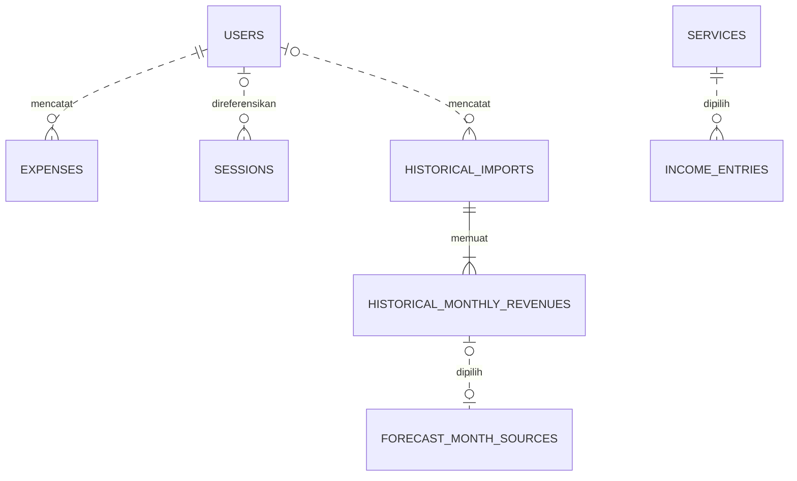
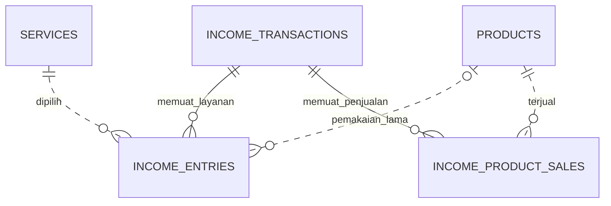

# Desain Database MySQL Sistem Manajemen Operasional Barbershop

**Kelompok 6, Kelas 2023C · Revisi kebutuhan · Draf untuk peninjauan**

Acuan kebutuhan fungsional adalah *Deskripsi Sistem (Terurut)* dari `deskripsi-sistem (2).md`, bagian 1–7, beserta konfirmasi kebutuhan lanjutan yang dicatat pada bagian 2. Sistem melayani satu lokasi. Kapster memulai sesi dengan nama dari beranda. Owner masuk menggunakan username dan kata sandi. Stack yang disepakati adalah Laravel 13.x, PHP 8.5.x, dan MySQL 8.4 LTS dengan Laragon. Perubahan terhadap lingkup dan kriteria penerimaan awal dicatat pada bagian 9. [Catatan fondasi Slice 00](Catatan-Pengerjaan-Slice-00.md) · [Acuan tugas kuliah](../tugas-kuliah/README.md)

Bagian 1–10 mencatat desain dasar dan rencana tiap slice. Deskripsi pencatatan satu layanan pada bagian 3 dan 4 mencatat skema awal Slice 05. Bagian 11 mencatat revisi transaksi dan produk yang sudah diterapkan. Tabel pengeluaran mengikuti implementasi Slice 07.

## 1. ERD usulan

### Tabel `users`

**Isi dan fungsi.** Akun untuk login Owner dengan username dan kata sandi. Owner adalah sebutan lain untuk Admin. Kedua istilah merujuk pada akun dan izin yang sama. Slice 01 mengubah tabel bawaan melalui migrasi baru.

| Kolom | Tipe MySQL | Kunci dan fungsi | Status |
| --- | --- | --- | --- |
| `id` | `BIGINT UNSIGNED AUTO_INCREMENT` | PK. Direferensikan oleh `expenses.recorded_by_user_id` dan `historical_imports.imported_by`. | Ada |
| `name` | `VARCHAR(255)` | Nama tampilan akun. | Ada |
| `email` | `VARCHAR(255)` pada fondasi | Atribut dari migrasi awal. | Dihapus pada Slice 01 |
| `email_verified_at` | `TIMESTAMP NULL` pada fondasi | Atribut dari migrasi awal. | Dihapus pada Slice 01 |
| `password` | `VARCHAR(255)` | Hash kata sandi Laravel. | Ada |
| `remember_token` | `VARCHAR(100) NULL` | Token bawaan jika fitur ingat saya dipakai. | Ada |
| `created_at`, `updated_at` | `TIMESTAMP NULL` | Waktu pembuatan dan pembaruan akun. | Ada |
| `username` | `VARCHAR(80) NULL`, ASCII | Unik dan tidak peka huruf besar/kecil. Normalisasi huruf kecil dan spasi tepi. Akun yang dibuat melalui perintah Owner wajib memiliki username. Baris lama tetap tersimpan dengan username kosong sehingga aksesnya belum aktif. | Ditambahkan pada Slice 01 |
| `disabled_at` | `DATETIME(6) NULL` | Waktu UTC saat akses akun dinonaktifkan. | Ditambahkan pada Slice 01 |

Satu Owner dapat mencatat nol hingga banyak pengeluaran. Satu record `sessions` bawaan dapat merujuk nol atau satu akun lewat `user_id`. Relasi ini bersifat logis karena migrasi bawaan memasang indeks pada `user_id`. Laravel menyimpan nama Kapster pada sesi tamu dan menyalinnya sebagai teks ke `income_entries.barber_name` saat menyimpan pemasukan. [Autentikasi Laravel](https://laravel.com/docs/13.x/authentication) · [Sesi Laravel](https://laravel.com/docs/13.x/session)

## 2. Perubahan kebutuhan dan keputusan terbuka

### Perbandingan dengan draf awal

| Area | Draf awal | Revisi |
| --- | --- | --- |
| Akun dan akses | Kasir dan Owner memakai akun Laravel. | Owner memakai username dan kata sandi. Kapster memulai sesi dari beranda dengan nama. |
| Pencatatan dan pemasukan | Checkout POS menghasilkan struk dan satu pemasukan per transaksi sah. | Satu transaksi Kapster dapat memuat beberapa layanan dan penjualan produk. Pemasukan membaca satu baris per item. Pembuatan struk dihapus dari Slice 05 dan 06. |
| Data layanan, kapster, pelanggan | Tiga master terpusat, transaksi menunjuk pelanggan dan kapster. | Nama Kapster berasal dari sesi. Nama pelanggan adalah keterangan teks opsional per pencatatan. Layanan berasal dari katalog dan harganya tampil otomatis. |
| Pengeluaran | Kasir mencatat tanggal, deskripsi, dan nominal. | Owner memasukkan tanggal, deskripsi, dan jumlah. Sistem menerbitkan ID pengeluaran. Riwayat mendukung pencarian dan ekspor Excel. |
| Laporan | Dashboard harian, mingguan, dan bulanan dengan rekap periode. | Home, Pemasukan, dan Pengeluaran menampilkan bulan berjalan. Home menampilkan total pemasukan, pengeluaran, dan hasil bersih serta grafik harian. Rekap menyajikan histori seluruh periode dan mendukung filter serta ekspor. |
| Peramalan | Satu Regresi Linier Python dengan proyeksi bulanan. | Tiga bulan historis lengkap WIB untuk memprediksi satu bulan berikutnya. Slice 11 menyediakan histori sintetis dan kontrak. Slice 12 mencakup model dan halaman. |

### Keputusan dan dampak skema

| ID | Status dan keputusan | Dampak pada desain |
| --- | --- | --- |
| K1 | **Dikonfirmasi 17 November 2026.** Nama Kapster diambil dari sesi. Nama pelanggan diisi sebagai teks opsional per transaksi dan tidak memerlukan profil atau riwayat kunjungan. | Slice 04 dilewati. Revisi Slice 05 menyimpan nama pelanggan pada `income_transactions.customer_name VARCHAR(120) NULL`. Masukan kosong disimpan sebagai `NULL`, dan daftar menampilkan `—` untuk nilai kosong. |
| K2 | **Dikonfirmasi.** Nama Kapster adalah teks, dengan nama sama diperbolehkan. **Keputusan teknis Slice 05.** Dashboard menampilkan pencatatan dari sesi browser aktif. | Slice 03 menyimpan `barber_name` pada sesi Laravel. Slice 05 menyalin nama itu ke pemasukan. Sidik SHA-256 dari ID sesi Laravel membatasi pembacaan, dan tanda tangan UUID mengikat satu form ke sesi yang sama. Kebutuhan melihat catatan lintas sesi oleh Kapster masih terbuka. |
| K3 | **Implementasi awal.** Slice 05 yang sudah di-merge menyimpan satu layanan per pencatatan. **Kebutuhan revisi.** Form Layanan dapat mencatat beberapa layanan dalam satu transaksi. Owner melihat satu baris per item. Harga muncul otomatis saat layanan dipilih. | Slice 02 menyediakan katalog layanan aktif yang dikelola Owner. Usulan revisi menambahkan transaksi induk dan mempertahankan snapshot layanan serta harga per item. Daftar layanan resmi masih terbuka. |
| K4 | **Dikonfirmasi.** Sistem membuat ID pengeluaran. | Implementasi Slice 07 menggunakan `expenses.id` yang dibuat oleh database dengan format tampilan dan ekspor `EXP-{id}`. |
| K5 | **Dikonfirmasi.** Home, Pemasukan, dan Pengeluaran memakai bulan berjalan. Rekap mencakup seluruh histori. | Pada pergantian bulan, halaman bulanan memakai rentang baru. Rekap tetap dapat membaca bulan sebelumnya dan menyediakan filter bulan atau jenis. |
| K6 | **Dikonfirmasi.** Pencatatan memakai layanan dan nominal, dengan aksi Kapster sebatas menambah. **Tafsiran draf.** Koreksi dan pembatalan yang diaktifkan berada di area Owner. | Slice 05 memakai waktu server dalam UTC. Kebutuhan mencatat pemasukan mundur masih terbuka. Sebelum Slice 08, pastikan cakupan koreksi atau pembatalan Owner, perlakuan periode, dan histori audit. Metode pembayaran dikeluarkan dari skema. |
| K7 | **Dikonfirmasi.** Owner dan Admin adalah dua sebutan untuk akun yang sama. | Satu jenis akun Owner. Slice 01 menambahkan username dan menghapus atribut email akun. |
| K8 | **Dikonfirmasi.** Data awal sintetis, 14–15 transaksi per hari operasional, tiga bulan historis, dan satu bulan prediksi. | Slice 11 menerapkan target pemasukan kotor dan bulan target pertama setelah tiga bulan lengkap WIB. Asumsi dataset mencakup Juli–Oktober 2026 dan nama pelanggan sebagian kosong. Pemetaan file aktual dan ambang MAE masih terbuka. |
| K9 | **Dikonfirmasi.** Dashboard Kapster memiliki tombol **Layanan** dan **Produk**. Form Layanan memuat minimal satu layanan dan bagian penjualan produk opsional. Form Produk mencatat penjualan saja. Owner mengisi katalog. | Pemasukan menjumlahkan layanan dan produk terjual. Kolom pemakaian produk dipertahankan untuk membaca catatan lama. Kebutuhan pencatatan stok masih terbuka. |
| K10 | **Dikonfirmasi.** Rekap komisi bulanan Kapster berada di luar lingkup aplikasi. | Foto rekap komisi menjadi acuan proses manual. Rancangan pemasukan hanya memakai nilai layanan dan penjualan produk. |
| K11 | **Dikonfirmasi 18 November 2026.** Rekap menampilkan hasil bersih dari pemasukan dan pengeluaran tercatat. | Slice 09 menghitung total pemasukan dikurangi total pengeluaran pada periode WIB yang sama. Tampilkan hasilnya pada Rekap dan XLSX. |

## 3. Kamus tabel lainnya

Pada tabel usulan, `ID` berarti `BIGINT UNSIGNED`, dengan `AUTO_INCREMENT` untuk PK tunggal `id`. `Rp` berarti `DECIMAL(15,0)` untuk rupiah utuh. `UTC` berarti `DATETIME(6)` berisi waktu UTC. Kolom wajib diisi kecuali dinyatakan `NULL`. PK adalah kunci primer, FK kunci asing, dan UQ kunci unik. Gunakan InnoDB, `utf8mb4`, dan hitung nominal dengan aritmetika presisi eksak. [MySQL DECIMAL](https://dev.mysql.com/doc/refman/8.4/en/fixed-point-types.html)

### Tabel `services` · implementasi Slice 02

**Isi dan fungsi.** Katalog pilihan layanan beserta harga aktif. Owner mengelola katalog dari pop-up Pemasukan yang memuat `/owner/services`. Endpoint baca-saja `GET /services/active` menyediakan `id`, `name`, dan `current_price` sebagai teks angka rupiah dari layanan dengan `archived_at IS NULL`. Satu layanan dapat dirujuk oleh banyak pemasukan.

| Kolom | Tipe | Kunci dan kegunaan |
| --- | --- | --- |
| `id` | `ID` | PK. Dirujuk oleh `income_entries.service_id`. |
| `name` | `VARCHAR(120)` | Label layanan pada dropdown. Gunakan nama placeholder untuk contoh dan pengujian selama daftar resmi masih terbuka. |
| `current_price` | `Rp` | Harga katalog saat ini, positif. |
| `archived_at` | `UTC NULL` | Saat layanan dikeluarkan dari pilihan aktif. |
| `created_at`, `updated_at` | `UTC` | Audit perubahan katalog. |

### Tabel `income_entries` · implementasi awal Slice 05

**Isi dan fungsi.** Satu baris per pencatatan Kapster yang berhasil disimpan. Setiap baris menunjuk tepat satu layanan, menyimpan nama Kapster dari sesi, dan memuat keterangan nama pelanggan jika diisi. Baris ini menjadi sumber pemasukan Owner, rekap, dan grafik.

| Kolom | Tipe | Kunci dan kegunaan |
| --- | --- | --- |
| `id` | `ID` | PK internal. |
| `barber_name` | `VARCHAR(120)` | Salinan nama Kapster dari sesi Laravel. Nama yang sama dapat muncul pada banyak catatan. |
| `customer_name` | `VARCHAR(120) NULL` | Teks opsional untuk keterangan pelanggan pada catatan tersebut. Atribut ini tidak memiliki FK. |
| `service_id` | `ID` | FK wajib ke `services.id`. Setiap pencatatan merujuk tepat satu layanan. |
| `service_name` | `VARCHAR(120)` | Salinan nama layanan saat simpan. |
| `amount` | `Rp` | Harga yang dicatat saat simpan. Tetap bernilai sama saat harga katalog berubah. |
| `recorded_at` | `UTC` | Waktu server saat pencatatan, sekaligus dasar periode pemasukan pada implementasi awal. |
| `session_scope` | `BINARY(32)` | SHA-256 ID sesi Laravel untuk membatasi daftar Kapster ke sesi aktif. Cakupan teknis ini bersifat per sesi browser dan tidak memiliki FK. |
| `request_key`, `request_hash` | `CHAR(36)` ASCII kolasi biner, `BINARY(32)` | UQ `request_key`. UUID per permintaan simpan dan SHA-256 payload. Kunci ini mengidentifikasi percobaan pencatatan. |

### Tabel `expenses` · implementasi Slice 07

**Isi dan fungsi.** Setiap baris menyimpan satu pengeluaran manual yang dicatat oleh satu Owner. Nilai ini dipakai untuk riwayat pengeluaran, rekap, dan grafik.

| Kolom | Tipe | Kunci dan kegunaan |
| --- | --- | --- |
| `id` | `BIGINT UNSIGNED AUTO_INCREMENT` | PK yang dibuat otomatis. Format referensi tampilan dan ekspor adalah `EXP-{id}`. |
| `incurred_on` | `DATE` | Tanggal pengeluaran dari form dalam kalender operasional. |
| `description` | `VARCHAR(255)` | Keterangan transaksi. |
| `amount` | `DECIMAL(15,0)` | Jumlah rupiah bulat dengan `CHECK (amount > 0)`. |
| `recorded_by_user_id` | `BIGINT UNSIGNED` | FK ke `users.id` dengan `ON DELETE RESTRICT` dan `ON UPDATE RESTRICT`. Diisi dari akun Owner yang aktif di server. |
| `created_at` | `DATETIME(6)` | Waktu penyimpanan UTC untuk audit, termasuk jika tanggal kejadian berbeda. |
| `request_key`, `request_hash` | `CHAR(36)` ASCII kolasi biner, `BINARY(32)` | UUID permintaan dan SHA-256 payload. UQ gabungan `(recorded_by_user_id, request_key)`. |

### Tabel pendukung Laravel yang sudah ada

Tabel berikut digunakan oleh infrastruktur Laravel. `sessions.user_id` dan `password_reset_tokens.email` menyimpan rujukan logis akun. Migrasi bawaan mempertahankan kedua rujukan sebagai kolom biasa. Tipe `VARCHAR` berikut memakai panjang 255 jika panjangnya tidak ditulis.

| Tabel | Kolom, tipe, dan kunci | Isi dan kegunaan |
| --- | --- | --- |
| `sessions` | `id VARCHAR PK`, `user_id BIGINT UNSIGNED NULL` berindeks, `ip_address VARCHAR(45) NULL`, `user_agent TEXT NULL`, `payload LONGTEXT`, `last_activity INT` berindeks | Penyimpanan sesi HTTP. Slice 03 menyimpan nama Kapster pada payload sesi tamu. Slice 05 menandatangani kunci form menggunakan ID sesi yang sudah ada. |
| `password_reset_tokens` | `email VARCHAR PK`, `token VARCHAR`, `created_at TIMESTAMP NULL` | Penyimpanan token reset kata sandi bila alur reset diaktifkan. |
| `cache` | `key VARCHAR PK`, `value MEDIUMTEXT`, `expiration BIGINT` berindeks | Nilai dan masa berlaku cache database. |
| `cache_locks` | `key VARCHAR PK`, `owner VARCHAR`, `expiration BIGINT` berindeks | Kunci proses yang dipakai cache Laravel. |
| `jobs` | `id ID PK`, `queue VARCHAR` berindeks, `payload LONGTEXT`, `attempts SMALLINT UNSIGNED`, `reserved_at INT UNSIGNED NULL`, `available_at INT UNSIGNED`, `created_at INT UNSIGNED` | Antrean pekerjaan Laravel. |
| `job_batches` | `id VARCHAR PK`, `name VARCHAR`, `total_jobs INT`, `pending_jobs INT`, `failed_jobs INT`, `failed_job_ids LONGTEXT`, `options MEDIUMTEXT NULL`, `cancelled_at INT NULL`, `created_at INT`, `finished_at INT NULL` | Status kelompok pekerjaan antrean. |
| `failed_jobs` | `id ID PK`, `uuid VARCHAR UQ`, `connection VARCHAR`, `queue VARCHAR`, `payload LONGTEXT`, `exception LONGTEXT`, `failed_at TIMESTAMP` dengan nilai awal waktu saat ini. Indeks `(connection, queue, failed_at)`. | Catatan pekerjaan yang gagal. Tipe kolom dan indeks mengikuti hasil inspeksi MySQL pengujian. |
| `migrations` | `id INT UNSIGNED AUTO_INCREMENT PK`, `migration VARCHAR`, `batch INT` | Riwayat file dan batch migrasi yang telah dijalankan. |

## 4. Integritas dan alur penyimpanan

- **Akun Owner.** Gunakan username unik dan kata sandi yang di-hash Laravel. Login dan rute Owner memeriksa bahwa akun telah diprovisikan sebagai Owner sesuai K7 dan masih aktif. Regenerasi ID sesi saat login dan invalidasi saat logout. Saat menonaktifkan akun, cabut sesi aktifnya. Tambahkan rate limit login, validasi server, proteksi CSRF, dan HTTPS pada lingkungan target. [Autentikasi Laravel](https://laravel.com/docs/13.x/authentication)
- **Sesi Kapster.** Slice 03 memvalidasi nama dari beranda dan menyimpannya sebagai teks pada sesi tamu Laravel. Dashboard dan form Tambah memerlukan sesi Kapster. Memulai sesi baru atau masuk sebagai Owner membersihkan konteks Kapster lama. Slice 05 membatasi dashboard ke sidik sesi browser aktif. Nama Kapster disalin untuk keterangan pada pemasukan. [Sesi Laravel](https://laravel.com/docs/13.x/session)
- **Pemasukan.** Form memuat pilihan satu layanan, dengan teks `Pilih layanan` saat pilihan kosong. Harga layanan yang dipilih tampil sebagai nilai baca-saja. Server mengambil nama Kapster dari sesi, menormalisasi nama pelanggan opsional, dan memeriksa layanan aktif. Transaksi memakai kunci baca pada baris katalog saat memvalidasi dan menyimpan snapshot. Jika harga yang dikirim berbeda dari harga katalog, form memuat harga terbaru dan meminta simpan ulang. Satu simpan berhasil menghasilkan satu baris pemasukan. Untuk layanan tambahan, buka form baru dan simpan dengan kunci permintaan baru. [Transaksi database Laravel](https://laravel.com/docs/13.x/database#database-transactions)
- **Pengeluaran.** Owner mengisi tanggal, deskripsi, dan jumlah. Tanggal awal mengikuti WIB dan Owner dapat memilih tanggal lain yang valid. Server memvalidasi isian, mengambil pencatat dari sesi login, menyimpan waktu simpan UTC, dan menampilkan referensi `EXP-{id}`. Pengiriman dengan UUID, pencatat, dan payload yang sama memakai catatan yang sudah tersimpan, sedangkan isi berbeda untuk UUID yang sudah dipakai ditolak. [Catatan Slice 07](Catatan-Pengerjaan-Slice-07.md)
- **Kirim ulang.** Server menerbitkan UUID baru dan tanda tangan HMAC untuk satu form. Saat menyimpan atau mengulang, server memverifikasi tanda tangan terhadap sesi aktif. Payload dinormalisasi untuk membentuk hash, termasuk nama Kapster, nama pelanggan opsional, layanan, dan harga yang dikonfirmasi. Kunci dan hash yang sama merujuk ke pemasukan yang sudah tersimpan. Jika isi berubah untuk kunci yang sudah dipakai, server meminta form baru. Jika pengiriman serentak menghasilkan konflik UQ, server membaca catatan yang menang dan mencocokkan sidik sesi serta hash payload. Ketentuan tersebut berlaku pada alur Kapster. Pengeluaran memakai aturan UUID per Owner pada alur di atas.
- **Data lama.** Semua FK domain memakai `ON DELETE RESTRICT` dan `ON UPDATE RESTRICT`. Owner dapat menghapus layanan atau produk yang belum memiliki rujukan transaksi. Item yang sudah tercatat dapat diarsipkan dan diaktifkan kembali. Produk dilindungi oleh FK penjualan `income_product_sales.product_id` dan pemakaian lama `income_entries.used_product_id`. Snapshot dipertahankan untuk Rekap lintas periode.
- **Koreksi.** Tindakan koreksi dan pembatalan yang disetujui melewati pemeriksaan izin Owner. Usulan Slice 08 mencatat pelaku, waktu, alasan, serta tautan antara catatan asli dan pengganti. Saat koreksi, simpan audit dan pengganti secara atomik. Isi dan status histori mengikuti hasil keputusan K6.
- **Constraint.** Terapkan `CHECK` untuk harga dan jumlah positif. Validasi nama Kapster pada awal sesi serta panjang nama pelanggan jika diisi. Validasi keterisian deskripsi, format tanggal, rentang nominal, dan status aktif di Laravel. [MySQL CHECK](https://dev.mysql.com/doc/refman/8.4/en/create-table-check-constraints.html)

| Tabel | Indeks utama selain PK | Pemakaian |
| --- | --- | --- |
| `users` | UQ `username` | Identitas akun dan login. |
| `services` | `(archived_at, name)` | Daftar layanan aktif. |
| `income_entries` | `(recorded_at, id)`, `(session_scope, recorded_at, id)`, indeks `service_id`, UQ `request_key` | Rekap periode, dashboard Kapster per sesi, FK layanan, dan pemeriksaan kirim ulang. |
| `expenses` | `(incurred_on, id)`, UQ `(recorded_by_user_id, request_key)` | Rekap periode, FK pencatat, dan simpan ulang. Pencarian ID yang tepat memakai PK `id`. |

## 5. Sumber laporan, grafik, dan ekspor

| Halaman Owner | Sumber dan cakupan | Pencarian, filter, dan ekspor |
| --- | --- | --- |
| Home | `OwnerFinancialEntries::query()` untuk kartu pemasukan, pengeluaran, dan hasil bersih bulan berjalan serta dua seri harian sejak tanggal 1 sampai hari ini. | Gunakan WIB. Hari yang sudah berjalan tanpa catatan bernilai Rp0. [Catatan Slice 10](Catatan-Pengerjaan-Slice-10.md) |
| Pemasukan | `IncomeItems::query()` dari `income_entries` dan `income_product_sales`, dengan waktu dari induk `income_transactions`. Cakupan bulan berjalan WIB. | Cari nama item, Kapster, pelanggan, atau ID transaksi. Total dan XLSX mengikuti seluruh hasil pencarian. Dari Pemasukan, Owner membuka pop-up katalog layanan dan produk. [Catatan Slice 06](Catatan-Pengerjaan-Slice-06.md) |
| Pengeluaran | `OwnerExpenseReport::query()` membaca `expenses` dari awal bulan WIB hingga sebelum awal bulan berikutnya berdasarkan `incurred_on`. | Cari ID pengeluaran atau deskripsi. Daftar, total, dan Excel memakai periode dan pencarian yang sama. [Catatan Slice 07](Catatan-Pengerjaan-Slice-07.md) |
| Rekap | Seluruh periode dari dua sumber. Baris dinormalisasi ke jenis, ID sumber, tanggal, nama Kapster bila ada, label, dan nominal. | Cari teks pada baris yang secara konsisten diproyeksikan ke rekap. Filter opsional dengan bulan dan jenis `IN` atau `OUT`. Ekspor seluruh rincian untuk pencarian dan filter yang sama, termasuk baris di luar halaman saat ini. Halaman dan XLSX memuat ringkasan pemasukan, pengeluaran, dan hasil bersih tercatat. |

**Periode.** Gunakan kalender operasional `Asia/Jakarta` dan interval `[awal bulan, awal bulan berikutnya)`. Hitung batas pemasukan dalam UTC dan bandingkan langsung dengan `recorded_at`. Untuk pengeluaran, pakai tanggal lokal pada `incurred_on`. Saat bulan berganti, Home menampilkan Rp0 dan tabel Pemasukan serta Pengeluaran kosong sampai ada catatan untuk bulan baru. Riwayat tetap tersimpan dan dapat dibaca melalui Rekap. [Fungsi tanggal dan waktu MySQL](https://dev.mysql.com/doc/refman/8.4/en/date-and-time-functions.html)

**Rekap.** `OwnerFinancialEntries` menggabungkan hasil `IncomeItems::query()` dan `expenses` dengan `UNION ALL` untuk Rekap dan Home. Gunakan pasangan `(item_type, source_id)` sebagai identitas baris karena ID layanan, penjualan produk, dan pengeluaran berasal dari tabel yang berbeda. Induk transaksi menyediakan waktu UTC dan ID yang ditampilkan pada baris pemasukan. Rekap mengurutkan rincian dengan tanggal, waktu pemasukan, kategori item, dan ID sumber agar paginasi serta ekspor konsisten. Bila bulan kosong, kedua sumber dibaca untuk seluruh periode. [Kueri bersama](../../app/Services/OwnerFinancialEntries.php)

Di implementasi, Laravel menerapkan satu pembentuk rentang dan sumber kueri laporan. Daftar dan XLSX memakai kueri rincian yang sama. Daftar dipaginasi, sedangkan XLSX mencakup seluruh hasil. Home memakai sumber keuangan yang sama untuk bulan berjalan WIB. Agregasi harian mengelompokkan `business_date` dan menjumlahkan masing-masing jenis. Kartu menjumlahkan seluruh tanggal bulan berjalan dan menghitung hasil bersih dari pemasukan dikurangi pengeluaran. Grafik menampilkan tanggal 1 sampai hari ini, termasuk hari tanpa catatan bernilai Rp0. Pilihan Batang atau Garis mengubah bentuk grafik. Tombol seri Pemasukan dan Pengeluaran mengubah rincian harian yang terlihat. Tanggal mendatang pada bulan berjalan muncul pada grafik saat tanggalnya tiba. XLSX menyimpan nominal sebagai angka selama muat dalam 15 digit presisi Excel. Nilai yang lebih panjang dan label masukan pengguna ditulis sebagai teks. Selisih antara layar, ekspor, dan pembanding dinilai pada data dan filter yang sama. Rekap, total bulanan, dan ekspor dihitung dari kueri tersebut.

**Hasil bersih tercatat pada Rekap.** Wajib hitung total pemasukan dikurangi total pengeluaran pada periode WIB yang sama. Pemasukan menjumlahkan nominal tiap layanan dan penjualan produk. Pengeluaran menjumlahkan `expenses.amount` berdasarkan `incurred_on`. Tampilkan kedua total dan hasil bersih di halaman serta XLSX. Gunakan Rp0 untuk jenis tanpa catatan dan pertahankan tanda negatif saat pengeluaran lebih besar. Ringkasan memakai bulan pilihan atau seluruh periode jika bulan kosong. Pencarian dan filter jenis berlaku pada rincian dan total nominal rincian. Saat **Semua jenis** dipilih, rincian juga memuat total pendapatan kotor dari pemasukan yang cocok dan total pendapatan bersih dari pemasukan dikurangi pengeluaran yang cocok. Ringkasan tetap memakai pemasukan dan pengeluaran dalam periode yang sama. XLSX menempatkan rincian dan ringkasan periode pada lembar masing-masing. [Catatan Slice 09](Catatan-Pengerjaan-Slice-09.md)

Rekap menampilkan tanggal pemasukan dalam WIB dan tanggal pengeluaran sesuai `incurred_on`. Baris `OUT` memakai `EXP-{id}` sebagai referensi. Slice 08 ditunda. Saat tindakan Owner pada K6 diimplementasikan, terapkan aturan status yang sama pada daftar, agregat, dan ekspor.

## 6. Sumber histori dan Forecasting

Slice 11 menyediakan data sintetis Juli–Oktober 2026. Pemasukan kotor dihitung dari harga saat pencatatan, mencakup layanan dan produk terjual. Alur membandingkan nominal item dengan rekap bulanan dari CSV privat. Database histori menyimpan agregat per batch dan metadata. Transaksi sumber dan nama pelanggan tetap di paket privat.

Bulan target memakai tiga bulan kalender WIB berurutan yang berakhir sebelum target. Contohnya Agustus–Oktober menjadi input untuk November. Juli–September dapat dipakai pada uji retrospektif Oktober. Slice 12 menjalankan Regresi Linier Python secara internal, menghitung MAE, dan menampilkan hasil ke Owner aktif. [Kontrak respons v1](../../forecasting/contract/v1/README.md) · [Catatan Slice 11](Catatan-Pengerjaan-Slice-11.md)

### Tabel `historical_imports`

**Isi dan fungsi.** Satu batch mencatat identitas paket dan versi validasi. Satu Owner dapat dirujuk banyak batch melalui opsi audit perintah.

| Kolom | Tipe MySQL | Kunci dan kegunaan |
| --- | --- | --- |
| `id` | `ID` | PK. |
| `dataset_version` | `VARCHAR(80)` | Versi dataset dari manifest. |
| `data_kind` | `VARCHAR(24)` | `synthetic` atau `actual`. |
| `manifest_sha256` | `CHAR(64)` | SHA-256 manifest. Bagian dari UQ identitas batch. |
| `mapping_version` | `VARCHAR(40)` | Versi format `csv-v1`. UQ bersama `manifest_sha256`. |
| `imported_at` | `DATETIME` | Waktu batch pertama kali disimpan dalam UTC. |
| `imported_by` | `BIGINT UNSIGNED NULL` | FK ke `users.id` dan berindeks. Dapat diisi dengan Owner aktif melalui CLI. |

### Tabel `historical_monthly_revenues`

**Isi dan fungsi.** Agregat per bulan di satu batch. Total nol sah ketika paket secara eksplisit menyatakan bulan lengkap.

| Kolom | Tipe MySQL | Kunci dan kegunaan |
| --- | --- | --- |
| `import_id` | `BIGINT UNSIGNED` | FK ke `historical_imports.id`. Kolom pertama PK gabungan. |
| `month_start` | `DATE` | Hari pertama bulan WIB. Kolom kedua PK gabungan. |
| `revenue` | `DECIMAL(30,0)` | Pemasukan kotor nonnegatif, divalidasi terhadap item. |
| `transaction_count` | `INT UNSIGNED` | Jumlah ID transaksi berbeda. |
| `is_complete` | `BOOLEAN` | Penanda kelengkapan kalender yang diklaim paket dan diperiksa terhadap cakupan tanggal. |

### Tabel `forecast_month_sources`

**Isi dan fungsi.** Satu pilihan sumber aktif per bulan. Pilihan aplikasi menyatakan operator sudah memeriksa kelengkapan bulan. Pilihan impor hanya dapat menunjuk agregat dari bulan yang sama.

| Kolom | Tipe MySQL | Kunci dan kegunaan |
| --- | --- | --- |
| `month_start` | `DATE` | PK. Hari pertama bulan WIB. |
| `source` | `VARCHAR(16)` | `application` atau `import`. |
| `import_id` | `BIGINT UNSIGNED NULL` | Kosong untuk `application`. Untuk `import`, FK berindeks bersama `month_start` ke PK `historical_monthly_revenues`. |

CHECK MySQL membatasi jenis data, hari pertama bulan, nominal nonnegatif, kelengkapan, serta kombinasi sumber dan ID. FK memakai `RESTRICT`. Impor menyimpan batch, agregat, dan pilihan sumber dalam satu transaksi. Identitas batch unik dan pemilihan sumber memakai PK bulan. Konflik aktivasi membatalkan seluruh transaksi. Penggantian sumber berlangsung melalui perintah pilihan eksplisit.

Pembaca sumber `application` menghitung item layanan dan penjualan produk dari `IncomeItems` pada rentang UTC yang ekuivalen dengan bulan WIB. Window menyatakan `insufficient_data` ketika bulan belum berakhir, belum dipilih, atau agregat impor belum lengkap. Hasil membawa asal per bulan dan label `mixed` jika operator memilih campuran aktual dan sintetis.

### Penyimpanan hasil Slice 12

Forecasting membaca tabel histori Slice 11. Laravel mengirim tiga agregat bulanan ke Python melalui stdin JSON. Saat tersedia empat bulan berturut-turut, bulan terakhir juga menjadi pembanding untuk model uji yang dilatih pada tiga bulan sebelumnya. Nilai hasil dibulatkan ke rupiah utuh. Prediksi negatif ditandai perlu ditinjau, dengan nilai mentah tersimpan pada metadata privat.

Snapshot terakhir dipublikasikan atomik pada `storage/app/private/forecasting/latest.json`. Snapshot mencatat versi model, sidik jari sumber, input, keluaran, evaluasi, dan waktu pembangkitan. Scheduler memeriksa kebutuhan pembaruan per jam. Penguncian cache mencegah pembangkitan serentak. Setelah bulan berganti, pemutakhiran memakai tiga bulan lengkap terbaru saat sumbernya tersedia. [Catatan Slice 12](Catatan-Pengerjaan-Slice-12.md)

## 7. Urutan migrasi Laravel yang diusulkan

Pemeriksaan repo menemukan tiga migrasi bawaan `0001_01_01_000000_create_users_table.php`, `0001_01_01_000001_create_cache_table.php`, dan `0001_01_01_000002_create_jobs_table.php`. `migrate:status --env=testing` menunjukkan ketiganya `Ran`. Ketiga migrasi yang terdaftar meliputi fondasi Laravel. Migrasi akun Slice 01 telah masuk ke `main` pada commit `34d6ace`. Slice 02 menambahkan migrasi katalog `0001_01_01_000004_create_services_table.php`. [Catatan Slice 00](Catatan-Pengerjaan-Slice-00.md)

| Urutan | Slice | Perubahan skema yang diusulkan | Dependensi dan keputusan |
| --- | --- | --- | --- |
| Dasar | 00 | Pertahankan migrasi bawaan `users`, `sessions`, cache, dan jobs serta riwayatnya. | Mulai migrasi fitur setelah PR fondasi disetujui dan di-merge. |
| 1 | 01 | `0001_01_01_000003_configure_owner_accounts.php` menambahkan username unik dan atribut penonaktifan, serta menghapus atribut email akun. | Akun aktif diprovisikan dengan `php artisan owner:create`. Rollback mengembalikan format skema awal dengan email placeholder unik bagi baris yang ada. |
| 2 | 02 | Migrasi `0001_01_01_000004_create_services_table.php` membuat `services` dengan harga positif dan indeks `(archived_at, name)`. | Owner mengelola katalog. Layanan diarsipkan lewat `archived_at`. Daftar resmi masih terbuka pada K3. |
| – | 03 | Sesi Kapster memakai `sessions` bawaan Laravel. | Nama tersimpan sebagai teks pada payload. Dashboard memakai sesi tamu aktif dan pratinjau membaca katalog Slice 02. |
| – | 04 | Master pelanggan dilewati. | K1 menetapkan bahwa nama pelanggan hanya keterangan opsional. |
| 3 | 05 | Migrasi `0001_01_01_000005_create_income_entries_table.php` membuat `income_entries` dengan satu FK wajib `service_id` dan `customer_name` opsional. | Bergantung pada `services`. Harga dan nama Kapster disalin saat simpan. `recorded_at` memakai waktu server UTC sesuai implementasi awal K6. |
| 4 | 05 revisi | Migrasi `000006`–`000008` membuat katalog produk, induk transaksi, dan rincian penjualan produk. | Jalankan sesudah `000005`. [Rincian migrasi revisi](#penyimpanan-migrasi-dan-pengujian) |
| 5 | 07 | Migrasi `0001_01_01_000009_create_expenses_table.php` membuat `expenses`. | Bergantung pada `users`. Sistem mengisi PK dan memakainya untuk referensi `EXP-{id}`. Rollback dibatasi pada tabel kosong. |
| Ditunda | 08 | Tambahkan atribut audit dan relasi pengganti sesuai alur yang disetujui. | K6. Owner memegang izin. Tetapkan cakupan tindakan, periode, dan aturan status sebelum migrasi. |
| 6 | 11 | Migrasi `0001_01_01_000010_create_forecasting_history_tables.php` membuat `historical_imports`, `historical_monthly_revenues`, lalu `forecast_month_sources`. | Uji pada MySQL 8.4. Rollback melepas tabel sesuai urutan FK pada skema yang belum berisi histori atau pilihan sumber. |

Slice 06, 09, dan 10 membaca sumber operasional yang sama. Slice 12 memakai sumber bulanan Slice 11 dan menyimpan snapshot privat tanpa migrasi tambahan. Gunakan migrasi baru setiap kali mengubah fondasi yang sudah diterapkan. Uji penerapan dan rollback pada MySQL 8.4 di skema uji terpisah. Dalam rollback skema fitur, lepaskan tabel anak sebelum induknya. [Migrasi Laravel](https://laravel.com/docs/13.x/migrations)

## 8. Data uji fiktif dan rekonsiliasi

Contoh mengikuti keputusan satu layanan per simpan dan memakai harga katalog. `Layanan A` dan `Layanan B` adalah placeholder. Nominal keduanya hanya untuk rekonsiliasi data uji. Waktu pada tabel adalah WIB. Harga Layanan A naik dari Rp35.000 menjadi Rp40.000 pada awal 1 Oktober. Gunakan target selisih Rp0 untuk pencatatan Kapster, pembukuan, grafik, dan ekspor pada data serta filter yang sama.

| ID uji | Jenis | Tanggal atau waktu lokal | Sesi atau pelaku | Layanan atau deskripsi | Nominal (Rp) |
| --- | --- | --- | --- | --- | ---: |
| I01 | Pemasukan | 29 Sep 2026 10:15:00 | Sesi A, Bayu | Layanan A | 35.000 |
| I02 | Pemasukan | 30 Sep 2026 18:00:00 | Sesi A, Bayu | Layanan B | 15.000 |
| I03 | Pemasukan | 30 Sep 2026 23:59:59.999999 | Sesi B, Bayu | Layanan A | 35.000 |
| I04 | Pemasukan | 1 Okt 2026 00:00:00 | Sesi C, Ari | Layanan A | 40.000 |
| E01 | Pengeluaran | 30 Sep 2026 | Owner | Perlengkapan | 20.000 |
| E02 | Pengeluaran | 1 Okt 2026 | Owner | Kebersihan | 5.000 |

| Periode | Pemasukan (Rp) | Pengeluaran (Rp) | Hasil bersih tercatat (Rp) |
| --- | ---: | ---: | ---: |
| 29 September | 35.000 | 0 | 35.000 |
| 30 September | 50.000 | 20.000 | 30.000 |
| September 2026 | 85.000 | 20.000 | 65.000 |
| 1 Oktober | 40.000 | 5.000 | 35.000 |
| Oktober 2026 | 40.000 | 5.000 | 35.000 |
| Seluruh periode | 125.000 | 25.000 | 100.000 |

- Dari sesi browser A, dashboard Kapster membaca I01 dan I02. Browser B membaca I03 berdasarkan kunci permintaan pada sesi B. Ketiganya menyimpan `barber_name = Bayu`. Owner melihat seluruh baris pada bulan yang sama.
- Uji I01 dengan `customer_name = Andi`, dan I02 dengan nama pelanggan kosong. I01 menyimpan teks nama dan I02 menyimpan `NULL`. Keduanya tetap menghasilkan pemasukan sesuai tabel pembanding.
- Kirim ulang I01 dengan UUID dan payload yang sama. Rekap September tetap memiliki tiga pemasukan. I01 dan I03 masing-masing dihitung Rp35.000 karena keduanya merupakan pencatatan sah yang berbeda.
- Pada uji terpisah, catat Layanan A (Rp35.000) dan Layanan B (Rp15.000) untuk satu kunjungan dalam dua simpan dengan kunci berbeda. Hasil yang diharapkan adalah dua baris pemasukan dengan total Rp50.000. Kirim ulang salah satu simpan dan pastikan jumlah baris serta totalnya tetap sama.
- Cek batas bulan. Tepat saat Oktober dimulai, I03 tetap berada di September dan I04 masuk Oktober. Uji bulan baru tanpa catatan dengan mengharapkan total Rp0 dan tabel kosong. Rekap September tetap menampilkan catatan terdahulu. Setelah harga Layanan A berubah, I01 dan I03 tetap bernilai Rp35.000.
- Cek hasil ekspor. Gunakan ID internal numerik 1 untuk I01 dan E01 saat pengujian. Kedua baris tetap tampil dengan jenis dan ID gabungan yang berbeda. Rekap September dengan filter pemasukan memuat I01–I03 dengan total Rp85.000. Rekap seluruh periode tanpa filter memuat enam entri. Grafik 30 September memuat Rp50.000 pemasukan dan Rp20.000 pengeluaran.

**Pemeriksaan draf.** Kueri Rekap dijalankan pada MySQL 8.4.3 dengan enam baris fiktif dari tabel di atas melalui CTE. Hasilnya cocok dengan pembanding September dan Oktober serta grafik 30 September. November yang kosong menghasilkan Rp0, dan Rekap lintas periode tetap memuat keenam catatan. Nama Kapster yang sama dan ID numerik yang sama pada jenis berbeda tetap muncul pada baris masing-masing. Uji penyimpanan, izin sesi, dan berkas XLSX dijalankan pada slice implementasi terkait.

## 9. Penyesuaian bukti penerimaan QMP

| Kriteria awal | Bukti pada kebutuhan terbaru dan keputusan yang masih diperlukan |
| --- | --- |
| KP-01 · Master operasional | Uji tambah, ubah, arsip, aktifkan kembali, dan hapus untuk kedua katalog sesuai kewenangan. Selaraskan kriteria awal QMP dengan nama Kapster dari sesi dan nama pelanggan opsional pada catatan (K1–K3). |
| KP-02 · Pencatatan dan pembukuan | Peragakan simpan Kapster dan input pengeluaran Owner. Bandingkan Pemasukan, Pengeluaran, Rekap, serta XLSX dengan data pembanding. Cocokkan ketiga nilai ringkasan Rekap, termasuk hasil bersih tercatat. Target selisih terhadap pembanding Rp0. |
| KP-03 · Dashboard | Cocokkan total bulanan dan grafik harian. Kriteria dashboard mingguan pada rancangan awal perlu diselaraskan dengan tampilan terbaru. |
| KP-04 · Autentikasi dan akses | Uji login Owner, akses langsung ke rute terbatas, akun nonaktif, dan cakupan baca dua sesi Kapster bernama sama. Uji izin pembatalan dan koreksi jika tindakan tersebut diterapkan. |
| KP-05 · Keamanan | Uji sesi Laravel, hash kata sandi, validasi, CSRF, dan HTTPS. Jika Forecasting dipakai, uji pemanggilan Python secara internal. |
| KP-06 · Peramalan | Bila disetujui, uji empat aktual dan dua prediksi sesuai sumbu waktu yang disepakati. Catat pemutakhiran bulanan dan status evaluasi galat. Jika fitur tidak disetujui, selaraskan KP-06 dengan Sponsor/Owner karena Charter dan QMP awal memasukkannya dalam lingkup. |
| KP-07 · Penyerahan | Catat versi migrasi, bukti uji aktual, hasil UAT Kapster dan Owner, serta keputusan penerimaan. |

## 10. Urutan pengerjaan per slice

| Slice | Pekerjaan dan dependensi | Kriteria selesai untuk revisi ini |
| --- | --- | --- |
| 00 · Fondasi dan tinjauan | Fondasi Laravel/MySQL telah diuji. Tinjau dampak deskripsi terbaru pada kontrak frontend dan daftar keputusan. | PR fondasi telah disetujui dan masuk `main`. Keputusan yang memengaruhi tiap slice dicatat sebelum migrasi terkait. |
| 01 · Akun Owner | Gunakan `users` dan `sessions` bawaan. Terapkan username, akses Owner, dan logout setelah Slice 00. | Akun yang disetujui dapat login. Sesi Kapster dan pengguna tanpa login ditolak pada rute Owner. Akun nonaktif kehilangan akses. |
| 02 · Katalog layanan | Buat katalog, pilihan layanan aktif, dan perubahan harga/arsip menurut K3. | Layanan dan harga yang sah tersedia bagi form Kapster sesuai kewenangan pengelola yang disepakati. |
| 03 · Sesi Kapster | Mulai dan akhiri sesi tamu dengan nama teks. Lindungi dashboard, pisahkan konteks Owner, dan buka pratinjau Tambah. | Alur dan isolasi sesi lulus uji. Pratinjau menampilkan layanan aktif beserta harga. [Catatan Slice 03](Catatan-Pengerjaan-Slice-03.md) |
| 04 · Master pelanggan | Dilewati sesuai keputusan K1. | Nama pelanggan ditangani sebagai keterangan opsional pada Slice 05. |
| 05 · Pencatatan Kapster | Pencatatan awal satu layanan dikembangkan menjadi transaksi multi-layanan. Form Layanan memuat penjualan produk opsional, dan form Produk khusus penjualan. Owner mengelola katalog serta status layanan. | Sudah di-merge. Uji kedua form, pemulihan arsip, perlindungan riwayat, kirim ulang, dan rekonsiliasi. [Catatan Slice 05](Catatan-Pengerjaan-Slice-05.md#revisi-kebutuhan-setelah-merge) |
| 06 · Pemasukan Owner | Membaca rincian layanan dan penjualan produk pada bulan berjalan WIB. Menyediakan pencarian dan XLSX. | Sudah di-merge. Setiap item tampil sekali dengan ID induk. Layar, total, dan ekspor memakai filter yang sama. [Catatan Slice 06](Catatan-Pengerjaan-Slice-06.md) |
| 07 · Pengeluaran Owner | Mencatat tanggal, deskripsi, dan jumlah. Menyediakan ID sistem, pencarian, total, dan XLSX periode berjalan. | Selesai dan di-merge. Kirim ulang menghasilkan satu catatan dengan ID yang sama. Total daftar dan XLSX cocok dengan pembanding dengan selisih Rp0. [Catatan Slice 07](Catatan-Pengerjaan-Slice-07.md) |
| 08 · Tindakan Owner bersyarat | Ditunda per 18 November 2026. Tetapkan cakupan berdasarkan K6 saat pengerjaan dilanjutkan. | Jika diterapkan, izin terbatas pada Owner. Histori dan perhitungan rekapan dapat direkonsiliasi. |
| 09 · Rekap lintas periode | Gabungkan hasil Slice 06–07. Sediakan pencarian, filter bulan/jenis, hasil bersih tercatat, dan XLSX. | Selesai dan di-merge. Histori dan rincian Excel cocok dengan filter. Ringkasan halaman dan Excel memuat total pemasukan, total pengeluaran, serta hasil bersih pada periode yang sama dengan selisih Rp0 terhadap pembanding. [Catatan Slice 09](Catatan-Pengerjaan-Slice-09.md) |
| 10 · Home bulanan | Hitung pemasukan, pengeluaran, dan hasil bersih bulan berjalan dari sumber Rekap. Sajikan dua seri harian dalam bentuk Batang atau Garis dengan tombol seri. | Selesai dan di-merge. Total Home dan Rekap cocok pada bulan yang sama. Pergantian bulan menghitung rentang baru, dan hari tanpa catatan bernilai Rp0. [Catatan Slice 10](Catatan-Pengerjaan-Slice-10.md) |
| 11 · Histori Forecasting | Generator sintetis, validasi dan impor ulang CSV privat, pemilih sumber bulanan, pembaca tiga bulan, serta kontrak v1. | Dalam review. Uji selisih Rp0, impor serentak, konflik aktivasi, dan batas WIB. [Catatan Slice 11](Catatan-Pengerjaan-Slice-11.md) |
| 12 · Model dan halaman Forecasting | Jalankan satu Regresi Linier internal dengan tiga bulan historis. | Siap review pada branch integrasi. Tersedia tiga historis dan satu prediksi, evaluasi MAE sintetis, pemutakhiran terjadwal, serta akses Owner. [Catatan Slice 12](Catatan-Pengerjaan-Slice-12.md) |
| 13 · Uji integrasi dan UAT | Uji migrasi MySQL, alur Kapster, akses Owner, ekspor dan rekonsiliasi. Sertakan peramalan jika disetujui. | Hasil aktual, status KP, temuan, dan uji ulang terdokumentasi. |
| 14 · Penerapan dan penyerahan | Setelah pemeriksaan fungsi inti, uji lingkungan target dan catat keputusan penerimaan. | Dokumentasi skema, hasil uji, serta keputusan penerimaan tersedia. |

Lihat peta kesiapan untuk menentukan halaman yang sudah dapat memakai alur backend dari `main`. [Peta kesiapan per tahap](Rencana-Backend-Sistem-Operasional-Barbershop.md#kesiapan-frontend-per-tahap)

## 11. Usulan revisi Slice 05 — transaksi multi-layanan dan pilihan produk

Implementasi pada branch revisi mencakup tiga migrasi Laravel (`000006`–`000008`), katalog produk Owner, dua form Kapster, dan satu kueri sumber pemasukan per item. [Catatan dan hasil uji revisi](Catatan-Pengerjaan-Slice-05.md#revisi-kebutuhan-setelah-merge)

### Alur yang diminta

Dashboard Kapster menyediakan dua tombol. Nama Kapster diambil dari sesi dan nama pelanggan tetap opsional di kedua form.

| Tombol | Isi form | Aturan simpan |
| --- | --- | --- |
| **Layanan** | Satu atau beberapa layanan pada bagian **Layanan**. Produk yang terjual diisi pada bagian **Produk dijual (opsional)**. | Wajib minimal satu item layanan. |
| **Produk** | Daftar produk yang dibeli pelanggan. Kapster memilih produk dan memasukkan jumlah. | Wajib minimal satu item penjualan produk. |

- Owner menambahkan pilihan produk ke katalog. Kapster memakai katalog yang sama di kedua form. Harga satuan produk terjual diambil dari katalog.
- Pemasukan Owner pada Slice 06 menampilkan satu baris per item layanan dan penjualan. Baris dari transaksi yang sama memakai ID transaksi yang sama. Keterangan pemakaian produk dari versi sebelumnya dapat ditampilkan pada riwayat.

### Acuan rekap manual

Dua foto yang diberikan pengguna memperlihatkan laporan pemasukan barbershop dan perhitungan komisi Kapster. Pemasukan perlu mencakup penjualan produk. Komisi bulanan berada di luar lingkup aplikasi sesuai konfirmasi pengguna.

| Acuan | Perhitungan yang dapat dicocokkan | Dampak pada desain |
| --- | --- | --- |
| Gambar 1 · rekap harian | 18 × Rp18.000 + Keramas Rp5.000 + Hair Tonic Rp15.000 = Rp344.000. | Penjualan produk memiliki nilai rupiah sendiri. Tulisan QRIS dan Rp230.000 perlu penjelasan jika dipakai untuk rekonsiliasi. |
| Gambar 2 · komisi jasa bulanan | 300 × Rp18.000 + tambahan Rp25.000 + 11 × Rp5.000 = Rp5.480.000. Komisi contoh 45% × Rp5.480.000 = Rp2.466.000. | Perhitungan komisi tetap menjadi acuan proses manual. |
| Gambar 2 · komisi produk dan total Kapster | Bagian Penjualan produk menunjukkan komisi Rp9.000 + Rp3.000 + Rp8.000 + Rp2.000 = Rp22.000. Komisi jasa, komisi produk, serta dua tambahan Rp91.000 dan Rp910.000 berjumlah Rp3.489.000. Kolom Gaji yang diterima tertulis Rp3.500.000. | Angka komisi produk di kertas adalah bagian penghasilan Kapster. Pemasukan dari penjualan di aplikasi dihitung dari jumlah dan harga jual. |

### Skema revisi Slice 05

| Tabel | Perubahan yang diusulkan |
| --- | --- |
| `income_transactions` | PK `id`. Simpan nama Kapster dari sesi, nama pelanggan opsional, waktu pencatatan UTC, cakupan sesi, kunci permintaan unik, dan hash payload transaksi. Indeks `(recorded_at, id)` untuk laporan dan `(session_scope, recorded_at, id)` untuk dashboard sesi. |
| `income_entries` | Pertahankan ID, snapshot layanan dan harga, serta FK wajib `income_transaction_id`. FK opsional `used_product_id` dan snapshot `used_product_name VARCHAR(120) NULL` dipertahankan untuk riwayat pemakaian produk dari versi sebelumnya. |
| `products` | PK `id`, `name VARCHAR(120)`, `sale_price DECIMAL(15,0) NULL`, dan `archived_at DATETIME(6) NULL`. Owner mengisi katalog. Form penjualan Kapster hanya menampilkan produk aktif dengan harga jual positif. |
| `income_product_sales` | PK `id`. FK wajib `income_transaction_id` ke induk dan `product_id` ke katalog. Simpan `product_name VARCHAR(120)`, `quantity INT UNSIGNED` positif, dan snapshot `unit_price DECIMAL(15,0)` positif. Nilai penjualan per item dihitung dari `quantity × unit_price`. |

Setiap transaksi memiliki minimal satu item yang menghasilkan pemasukan. Form **Layanan** mensyaratkan layanan, sementara form **Produk** mensyaratkan penjualan produk dan menolak item layanan. Laravel menerapkan validasi sesuai rute sebelum menyimpan induk dan item. Produk yang sudah direferensikan dapat diarsipkan dan diaktifkan kembali. FK memakai `RESTRICT` untuk melindungi riwayat penjualan dan pemakaian. Produk tanpa rujukan dapat dihapus.

### Sumber pemasukan Owner

`IncomeItems::query()` menormalisasi layanan dan penjualan produk dari transaksi induk dengan `UNION ALL`. Identitas baris memakai pasangan jenis dan ID item. Layanan menyumbang snapshot harga. Penjualan produk menyumbang jumlah kali snapshot harga satuan. Pemakaian produk lama tetap tampil sebagai keterangan. Slice 06 menerapkan cakupan bulan berjalan dan pencarian melalui `OwnerIncomeReport` bagi daftar, total, serta XLSX.

### Penyimpanan, migrasi, dan pengujian

1. Migrasi `000006_create_products_table` menambah katalog produk. Migrasi `000007_group_income_entries_into_transactions` membuat induk dan mengaitkan satu transaksi ke setiap catatan lama. ID item, waktu, dan nominal lama dipertahankan.
2. Setelah backfill, migrasi `000007` mewajibkan FK induk, menambah FK pemakaian produk opsional, dan memindahkan kunci kirim ulang ke induk. Migrasi `000008_create_income_product_sales_table` menambah rincian penjualan produk.
3. Terapkan validasi per form, termasuk pilihan produk, jumlah, dan harga katalog. Kedua form memakai alur simpan yang sama untuk menyimpan induk beserta seluruh rincian dalam satu transaksi database. Kirim ulang dengan kunci dan payload yang sama mengembalikan transaksi yang telah tersimpan.
4. Uji form **Layanan** dengan Layanan A Rp35.000, Layanan B Rp15.000, dan penjualan dua unit produk seharga Rp15.000 per unit. Pemasukan Owner memuat tiga baris dengan ID transaksi sama dan total Rp80.000. Uji juga form Layanan dengan penjualan kosong dan dengan layanan kosong.
5. Uji form **Produk** dengan penjualan dua unit produk seharga Rp15.000 per unit. Pemasukan Owner memuat satu baris penjualan senilai Rp30.000. Uji penolakan daftar produk kosong dan permintaan yang menyisipkan item layanan.
6. Uji kirim ulang pada kedua form, penolakan item tidak valid, dan selisih Rp0 sebelum serta sesudah backfill data lama. Pada kasus gagal, jumlah transaksi, jumlah item, dan total pemasukan harus sama dengan keadaan sebelum pengiriman.
7. Uji bahwa layanan yang diarsipkan hilang dari pilihan Kapster, lalu muncul kembali setelah diaktifkan. Uji penghapusan layanan yang belum tercatat serta perlindungan layanan yang memiliki riwayat.
